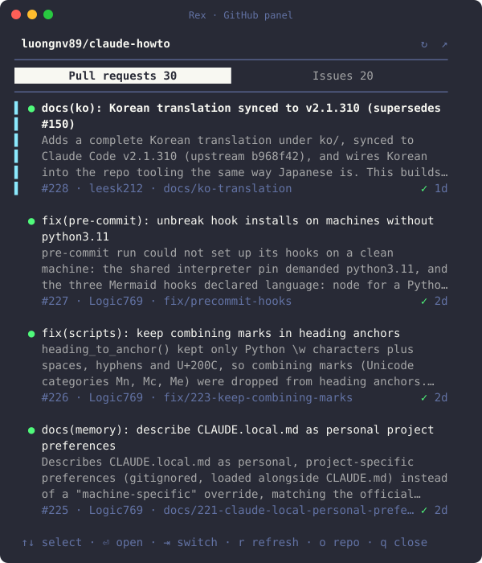

# rex-extensions

[](https://github.com/luongnv89/rex-extensions/actions/workflows/ci.yml)
[](LICENSE)

Extensions for Rex, the terminal multiplexer. Each one is a folder with a Lua file that Rex's `init.lua` loads, plus whatever the extension runs, and an `install.js` that adds it to your config.

| Extension | What it does | Default key |
| --- | --- | --- |
| [github](github/README.md) | The open pull requests and issues of the repo you're in, from GitHub or GitLab, in a side pane. Resolve an issue or review a pull request with an agent, from a button on each row, with the agent profile and prompt you choose, and merge a pull request from its own Merge button. | `cmd+shift+g` |
| [mcc](mcc/README.md) | The 5-hour and weekly Claude Code usage of every [mcc](https://github.com/luongnv89/mcc) account, in a strip along the bottom of the tab, with a button to look them up live, and the machine's CPU, memory and network. | `cmd+shift+u` |
| [tabs](tabs/README.md) | The machine in each session's name and the folder in each tab's name, such as `devbox` over `skills · claude`, so the sidebar shows where every tab is. Works over ssh. | `cmd+shift+l` |
| [sshtab](sshtab/README.md) | A new tab or split pane opened from one that's ssh'd into a machine connects to that machine too, with the same ssh options, from the + button, the menu, the command palette or the keys. After Rex restarts, the Claude Code, Codex and other agent sessions that were running come back in their panes and folders. | `cmd+alt+t` |



The github panel. The other extensions show their output in their own READMEs.

<!-- TODO: add a screenshot or GIF of tabs and sshtab in the Rex sidebar, for example docs/demo.gif. -->

## Quick start

```sh
git clone https://github.com/luongnv89/rex-extensions ~/.config/rex/rex-extensions
node ~/.config/rex/rex-extensions/github/install.js
```

Then press `cmd+shift+g` in a Rex pane inside a GitHub or GitLab repo, or the key `install.js` says it picked. The github panel needs [`gh`](https://cli.github.com) or [`glab`](https://gitlab.com/gitlab-org/cli), logged in, plus Rex and Node 20 or later (see [Needs](#needs)). [Install](#install) explains each step.

## Install

Rex has no plugin manager. An extension is enabled when the `init.lua` Rex reads loads its Lua file and binds a key to its action. Each extension's `install.js` makes that edit for you.

### 1. Clone the repo once

```sh
git clone https://github.com/luongnv89/rex-extensions ~/.config/rex/rex-extensions
```

Any folder works. `init.lua` loads the extensions from where you cloned them, so keep the clone there.

### 2. Install and enable the extensions you want

Run each extension's `install.js`:

```sh
node ~/.config/rex/rex-extensions/github/install.js
node ~/.config/rex/rex-extensions/mcc/install.js
node ~/.config/rex/rex-extensions/tabs/install.js
node ~/.config/rex/rex-extensions/sshtab/install.js
```

Each one:

1. adds three lines to `init.lua`: a comment, a `dofile` that loads the extension, and a `rex.bind` for its key;
2. checks the result with `rex config check`, and puts the old file back if the check fails;
3. saves the old file as `init.lua.bak-rex-<extension>`;
4. runs `rex config reload`, so the key works at once, with no restart.

The file it edits is `REX_CONFIG` when that's set, else `$XDG_CONFIG_HOME/rex/init.lua`, else `~/.config/rex/init.lua`. It's created if it doesn't exist. Running `install.js` again when the extension is already there changes nothing.

For mcc, the lines look like this:

```lua
-- rex-mcc: the mcc usage panel (https://github.com/luongnv89/rex-extensions/tree/main/mcc)
dofile("/Users/you/.config/rex/rex-extensions/mcc/rex-mcc.lua")
rex.bind("cmd+shift+u", "mcc_usage")
```

### 3. Use it

Press the extension's key in any Rex pane:

| Extension | Key | Action | In the command palette |
| --- | --- | --- | --- |
| github | `cmd+shift+g` | `github_panel` | **PR and Issue Panel** |
| mcc | `cmd+shift+u` | `mcc_usage` | **mcc Usage Panel** |
| tabs | `cmd+shift+l` | `tab_locations` | **Tab Locations** (turns it off or on; it runs on its own) |
| sshtab | `cmd+alt+t` | `same_host_tabs` | **Same-Machine Tabs** (turns it off or on; it runs on its own). `restore_agent_sessions`, **Restore Agent Sessions**, turns agent session restore alone off or on. |

Without the key, pick the extension in Rex's command palette, or run its action from a shell with `rex do ACTION`, such as `rex do mcc_usage`.

To check that an extension is enabled:

```sh
rex config check                  # init.lua loads without errors
rex keymap | grep mcc_usage       # the key is bound to the action
```

### Pick another key

When the default key is already bound in your `init.lua`, `install.js` takes the first free key from its own list and says which one it picked. To choose a key yourself, pass it:

```sh
node ~/.config/rex/rex-extensions/mcc/install.js ctrl+alt+u
```

It refuses a key your `init.lua` already binds. It can't see the shortcuts built into the Rex app, so if the key does something else there, remove the extension and install it again with another key.

### Enable it by hand

To skip `install.js`, add the `dofile` and `rex.bind` lines above to `init.lua` yourself, using the path of your clone, then run `rex config check` and `rex config reload`.

### Update, disable or remove

- **Update:** run `git pull` in the clone. Every extension updates at once. A change to a pane's script shows the next time the pane opens; a change to an extension's Lua file needs `rex config reload`.
- **Disable or remove:** `node ~/.config/rex/rex-extensions/mcc/install.js --remove` takes the extension's lines out of `init.lua` and reloads the config. Run `install.js` again to bring it back.

## Configuration

Each extension is configured by its key, which you pass to `install.js`, and by a few environment variables:

| Variable | Used by | What it does |
| --- | --- | --- |
| `REX_CONFIG` | every `install.js` | The `init.lua` to edit. Else `$XDG_CONFIG_HOME/rex/init.lua`, else `~/.config/rex/init.lua`. |
| `XDG_STATE_HOME` | github and mcc panels | Where the panel keeps its state file. Default `~/.local/state`. |
| `MCC_BIN` | mcc panel | The full path to `mcc`, when it isn't on `PATH` or in the usual install folders. |
| `REX_GITHUB_STARTUP_MS` | github panel | How long Resolve/Review waits for the agent to start, in ms. Default 3000. |

[docs/DEVELOPMENT.md](docs/DEVELOPMENT.md#environment-variables) lists the rest, which are mostly for tests.

## Needs

- Rex on macOS or Linux.
- Node 20 or later, as `node` on the `PATH` your login shell sets.
- Whatever an extension lists in its own README.

## Layout

```
rex-extensions/
  github/ mcc/ tabs/ sshtab/   one folder per extension
  docs/                        architecture, development guide, changelog index
  .github/                     CI workflow, issue and pull request templates
```

Each extension folder holds:

```
<extension>/
  rex-<name>.lua  the actions init.lua loads with dofile
  install.js      adds the extension to init.lua, or --remove takes it out
  test/           node --test tests, run by CI
  README.md       what it does, its keys, what it runs
  CHANGELOG.md
```

An extension is self-contained: no npm packages, nothing shared between folders, so each one can be installed, removed and versioned on its own.

## Develop

```sh
git clone https://github.com/luongnv89/rex-extensions
cd rex-extensions/github
node --test
rex do ./rex-github.lua --action github_panel
```

`rex do FILE --action NAME` runs an extension's action from your clone without installing it.

## Documentation

- [docs/ARCHITECTURE.md](docs/ARCHITECTURE.md): how Rex loads an extension, the shared install flow, and the panel and watcher patterns.
- [docs/DEVELOPMENT.md](docs/DEVELOPMENT.md): requirements, tests, environment variables and debugging.
- [docs/CHANGELOG.md](docs/CHANGELOG.md): where each extension's changelog is.
- Each extension's README: [github](github/README.md), [mcc](mcc/README.md), [tabs](tabs/README.md), [sshtab](sshtab/README.md).

## Contributing

Bug reports, fixes and new extensions are welcome. Read [CONTRIBUTING.md](CONTRIBUTING.md) first, and follow the [Code of Conduct](CODE_OF_CONDUCT.md). Report security issues privately, as [SECURITY.md](SECURITY.md) explains, not in a public issue.

## License

[MIT](LICENSE)

## Acknowledgments

- Built on Rex, the terminal multiplexer, and its Lua config and `rex` CLI.
- The mcc panel is the Rex twin of [mcc-herdr-plugin](https://github.com/luongnv89/mcc-herdr-plugin), the same panel for Herdr.
- The github panel uses [`gh`](https://cli.github.com) and [`glab`](https://gitlab.com/gitlab-org/cli); the mcc panel uses [mcc](https://github.com/luongnv89/mcc).
