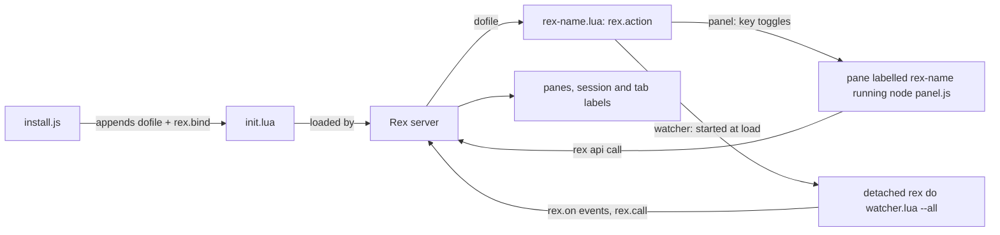

# Architecture

How the extensions hook into Rex. This is for contributors; for what each extension does and how to use it, see its README: [github](../github/README.md), [mcc](../mcc/README.md), [tabs](../tabs/README.md), [sshtab](../sshtab/README.md).

## How Rex loads an extension

Rex has no plugin manager. Its server runs `init.lua`, in Lua 5.1. An extension is enabled by two lines there:

- a `dofile(".../rex-<name>.lua")`, which registers one action with `rex.action`;
- a `rex.bind(key, action)`, which binds a key to it.

The command palette lists the action by its `title`, and `rex do <action>` runs it from a shell.

## The shared install flow

Every `install.js` is the same code with different constants (`ACTION`, `MODULE`, `CANDIDATES`, `MARKER` and the `REX_<NAME>_*` variables). It:

1. Resolves the config path: `REX_CONFIG`, else `$XDG_CONFIG_HOME/rex/init.lua`, else `~/.config/rex/init.lua`.
2. Does nothing if the config already loads the extension (`loadsModule`), so running it twice is safe.
3. Refuses to touch a config that already fails `rex config check`.
4. Lists the keys the config binds, with a `rex do -e` script that stubs out `rex.on`, `rex.every` and `rex.after`, loads `init.lua` and reads `rex.bindings()`. `rex.args` is set inside `rex do`, which is how the watcher extensions know not to start their watcher then.
5. Picks the key that was asked for, or the first free one of `CANDIDATES` (`pickKey`).
6. Saves the old file as `init.lua.bak-rex-<name>` and appends three lines: the `MARKER` comment, the `dofile` and the `rex.bind`. Paths and keys are written as Lua strings, and any with control characters are refused.
7. Runs `rex config check` again and puts the old file back if it fails.
8. Runs `rex config reload`.

`--remove` strips the block by its `MARKER`. The watcher extensions also stop their watcher first, and tabs puts the original names back. sshtab's install also replaces the lines of an earlier version that bound `cmd+t` to a `same_host_tab` action.

## Pattern A: panel extensions (github, mcc)

- The action reads the tab with `session.view` and looks for a block labelled `rex-<name>` in the focused pane's tab.
  - If there is one, it closes it with `block.close`.
  - If not, it opens one with `session.new_split`, running `node panel.js`: github on the right, mcc along the bottom at a quarter of its height. github then fits its own width (36 columns, or the width the user last dragged it to) and mcc its own height with `session.resize_pane`.
  - The action runs on the machine whose `init.lua` bound the key, but the pane runs on the machine of the server holding the session, which can be a remote host. So when `panel.js` is under `$HOME`, the command is `sh -c 'p=$1; shift; exec node "$HOME$p" "$@"'` with the path relative to `$HOME` as an argument, and the pane's machine finds its own copy at the same `$HOME`-relative path. Otherwise it's `node` with the full path. The pane starts in the focused pane's folder (github) or its machine's default folder, never in the extension's folder.
- The label is the only state: nothing is kept on disk to find the panel again.
- `panel.js` reads `REX_SESSION` and `REX_BLOCK` and talks to Rex with `rex api call -s <session>`. github polls every 2 seconds to follow the focused pane and its folder; mcc reloads usage every 30 seconds and samples the machine's CPU, memory and network every 5.
- It shells out to `git` and `gh` or `glab` (github) or `mcc`, `vm_stat` and `netstat` (mcc), and keeps small state files under `$XDG_STATE_HOME` (default `~/.local/state`).
- github's Resolve and Review run `rex split` to start the chosen profile's agent in a pane to the right of yours (or of the pane the panel follows), and read and write `~/.config/rex-github/profiles.json`.

The full list of what each panel runs is in its README's "What it runs": [github](../github/README.md#what-it-runs), [mcc](../mcc/README.md#what-it-runs).

## Pattern B: watcher extensions (tabs, sshtab)

- When `rex-<name>.lua` is loaded by the server (`rex.args == nil`), it starts `rex do watcher.lua --all state=~/.cache/rex-<name>` with `rex.exec.start{ detach = true }`.
  - Only one watcher runs. Its pid is kept in `watcher.pid` and checked with `ps` against the command line, so a reused pid doesn't count.
  - An `off` file in the same folder keeps it off across restarts. The action toggles it.
  - `rex_bin()` uses the `rex` on `PATH`, else the one inside the Rex app on macOS.
- `watcher.lua` subscribes to events with `rex.on`, uses `rex.after` for debouncing and polling, and checks for the `off` file every second with `rex.every(1, ...)`.
  - **tabs** listens to `session_view_changed`, `session_created`, `terminal.title_changed`, `terminal.pwd_changed`, `terminal.process_changed`, `window_label_changed`, `session_label_changed`, `window_closed` and `session_destroyed`. It reads each terminal's `title`, `pwd` and `process`, and sets labels with `session.set_label` and `session.set_window_label`.
  - **sshtab** listens to `window_created`, `block_owner_changed`, `active_window_changed`, `block_closed`, `session_created`, `session_destroyed` and `terminal.process_changed`. It acts only on blocks whose creator client is of kind `app` (from `client.list`), and types the ssh command with the terminal's `write` once the shell waits at its prompt (`input_mode`). Each decision goes to `~/.cache/rex-sshtab/log`.
  - sshtab also keeps `agents.json`: the AI coding agent session each pane runs, found every 15 seconds (`rex.every`) and on `terminal.process_changed`. When the watcher starts, it compares `server.status`'s `instance_id` with the instance that last wrote the file. Within 120 seconds of the server's `started_at`, it types the resume line into each restored pane that ran an agent, once the pane is a plain shell at its prompt (`process`, `input_mode`, and the cursor line from `format`). `restore-off` turns this part off. The design, and how it compares with herdr's, is in [herdr-session-restore-study.md](herdr-session-restore-study.md).
- `lib.lua` holds the pure logic: finding a tab's machine and folder and building labels (tabs); parsing ssh command lines, recognising shells and finding the pane a split came from, and recognising agents, reading their session ids, building the resume line and planning a restore (sshtab). It makes no `rex` calls, so plain Lua 5.1 tests it through `test/lib_spec.lua`.

## Rex API surface

The server must speak API revision 8 or later.

| Call | Used by | For |
| --- | --- | --- |
| `rex.action` | all | Register the extension's action. |
| `rex.bind`, `rex.bindings` | every `install.js` (inside `rex do`) | List the keys `init.lua` binds, in Rex's normalized form. |
| `rex.args` | `install.js` scripts, watchers | Script arguments; also how `rex-tabs.lua`/`rex-sshtab.lua` tell a `rex do` run from a server load. |
| `rex.call("session.view")` | github, mcc, tabs, sshtab | Read a session's windows, layers and blocks. |
| `rex.call("session.new_split")` | github, mcc | Open the panel. |
| `rex.call("block.close")` | github, mcc | Close the panel. |
| `rex.call("block.method", { method = "process" })` | github (Lua and `panel.js`), mcc `panel.js` | The program running in a pane, and its folder. |
| `session.resize_pane` (via `rex api call`) | mcc `panel.js` | Fit the panel's height. |
| `rex.call("session.list")` | tabs, sshtab | Every session at start. |
| `rex.call("session.set_label")`, `rex.call("session.set_window_label")` | tabs | Rename sessions and tabs. |
| `rex.call("client.list")` | sshtab | The kind of client that created a block. |
| `rex.block.call` (terminal `title`, `pwd`, `process`, `input_mode`, `format`, `write`) | tabs, sshtab | Read a terminal's state and screen; type into it. |
| `rex.call("server.status")` | sshtab | The server's `instance_id` and `started_at`, to tell a restart from a watcher restart. |
| `rex.json` | sshtab | Read and write `agents.json` and Claude's `sessions/<pid>.json`. |
| `rex.exec`, `rex.exec.start` | tabs, sshtab | Run `ps`, `hostname`, `mkdir`, `test`, `chmod`; start the detached watcher. |
| `rex.on`, `rex.after`, `rex.every` | tabs, sshtab watchers | Events, debounce and polling, the `off` check, sshtab's agent sweep. |
| `rex.log` | tabs, sshtab | Warn when a watcher can't start. |
| `rex api call`, `rex split` (CLI) | github and mcc `panel.js` | Talk to Rex from the panel; start the agent pane. |

## Design principles

- **Self-contained folders.** The duplication between them is deliberate: each extension can be installed, removed and versioned on its own.
- **No dependencies.** Plain Node and Lua 5.1, no npm packages.
- **No hidden state.** Panels are found by their label; watchers keep only a pid file, an `off` file and, for sshtab, a log, a `restore-off` file and `agents.json`. `install.js --remove` deletes `agents.json`.
- **Leave other tools alone.** sshtab never types into a pane that a script or agent made, except to resume the agent session that pane ran before a server restart, and tabs keeps a name someone set by hand, only adding the machine or folder to it. Agent sessions are found without changing any agent's config: no hooks are installed.
- **"What it runs" is a contract.** Everything runs as your user with no sandbox, so each README says what it runs and writes. See [SECURITY.md](../SECURITY.md).

## Testing

- Each folder runs its own tests with `node --test`.
- `install.test.js` points `REX_<NAME>_REX` at a stand-in `rex` script, steered by `FAKE_REX_LOG` and `FAKE_REX_REJECT`, and `REX_CONFIG` at a temporary file.
- `github/test/panel.test.js` replaces `child_process.spawn` and `execFile` to fake `git`, `gh`, `glab` and `rex`.
- `tabs` and `sshtab` run `test/lib_spec.lua` under Lua 5.1 or LuaJIT through `test/lib.test.js`.
- `sshtab/test/restore.e2e.test.js` restarts a throwaway Rex server with a stand-in `claude` in two panes and checks each one is resumed once. It needs Rex and runs only with `REX_SSHTAB_E2E=1`, so CI skips it.

How to run them is in [DEVELOPMENT.md](DEVELOPMENT.md#run-the-checks).
