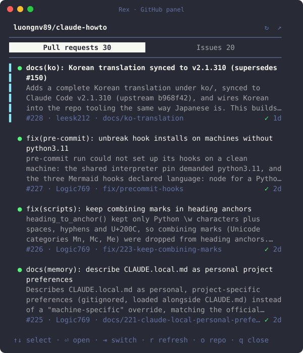

# GitHub panel for Rex

The open pull requests and issues of the repo you're in, in a side pane of Rex, the terminal multiplexer. Works with GitHub and GitLab, including self-hosted GitLab and GitHub Enterprise.



Each row shows the title (up to 2 lines), the description (up to 3 lines) and a meta line:

- **Pull requests** (merge requests on GitLab): number, author and branch, a Draft chip, the review state (Approved, Changes requested, Review), the checks (✓ passed, ● pending, ✗ failed) and the age.
- **Issues:** number and author, up to 3 labels in their colors, and the age.

The selected row also shows its URL on one more line.

On GitLab, merge requests show as `!123` and have no checks mark: the list doesn't carry pipeline status. Their review state shows Changes requested and Review, but not Approved.

Click a pull request or issue, or select it and press enter, to open it in your browser.

On GitHub, each issue has a **Resolve** button and each pull request a **Review** button, which start an agent on it. Which agent, model and thinking level is up to you: see [Agent profiles](#agent-profiles). So is the prompt it gets: see [Custom prompts](#custom-prompts). Each pull request, and each merge request on GitLab, also has a **Merge** button, which merges it once you press it a second time: see [Merge a pull request](#merge-a-pull-request). Each issue, on GitHub and GitLab, has a **Close** button, which closes it without resolving it, also once you press it a second time: see [Close an issue](#close-an-issue). On GitHub's issues, **Auto-pilot** (`☑` in the header, or `p`) puts a checkbox on every issue and runs one agent on the ones you check, with the IDD `auto-pilot` skill or a prompt of your own: see [Auto-pilot several issues](#auto-pilot-several-issues).

It is the Rex twin of [herdr-github](https://github.com/luongnv89/herdr-github), the same panel for herdr.

## Install

Rex has no plugin manager: its extensions are Lua in `init.lua`. Clone [rex-extensions](../README.md) anywhere, then let the panel add itself to your config:

```sh
git clone https://github.com/luongnv89/rex-extensions ~/.config/rex/rex-extensions
node ~/.config/rex/rex-extensions/github/install.js
```

`install.js` adds three lines to the `init.lua` Rex reads, then runs `rex config reload`:

```lua
-- rex-github: the PR and issue panel (https://github.com/luongnv89/rex-extensions/tree/main/github)
dofile("/Users/you/.config/rex/rex-extensions/github/rex-github.lua")
rex.bind("cmd+shift+g", "github_panel")
```

The file is `REX_CONFIG` when that's set, else `$XDG_CONFIG_HOME/rex/init.lua`, else `~/.config/rex/init.lua`; it's created if it doesn't exist.

- **Which key:** `cmd+shift+g`. If your `init.lua` already binds it, it takes the first free one of `cmd+alt+g`, `ctrl+shift+g`, `cmd+shift+i` and `ctrl+alt+g`, and says which. To choose, run `node github/install.js ctrl+alt+p`; it refuses a key your `init.lua` already binds. It can't see the shortcuts built into the Rex app, so if the key does something else, pick another one.
- **Safety:** if `rex config check` already reports a problem with your `init.lua`, it changes nothing, exits 1 and quotes the problem. If the check rejects the edited file, it puts the old one back and exits 1. It saves the old file next to it, as `init.lua.bak-rex-github`. If `init.lua` already loads `rex-github.lua`, it changes nothing.
- **Without a key:** the action is also in Rex's command palette, as **PR and Issue Panel**, and `rex do github_panel` runs it from a shell.

To update, `git pull` in the folder you cloned. To remove it, run `node github/install.js --remove`, which takes those three lines out again.

## Use

Press the key in any pane. The panel opens on the right of the tab, 36 columns wide: about the width of Rex's sidebar. It takes at most half the tab. Drag the border on its left to make it wider or narrower: the panel keeps that width from then on, also when a pane opens or closes in the tab and Rex evens out the tab's splits, and when you open it again, after Rex restarts too. Resizing Rex's window doesn't change the width it keeps. Press the key again in that tab, from any pane, to close it.

- **Which repo:** the folder of the last pane you focused in the panel's tab. It follows you when you `cd` or move to another pane.
- **Which site:** read from the repo's `origin` remote (or its first remote). A host name containing `github` uses `gh`, one containing `gitlab` uses `glab`, and any other host tries `gh`, then `glab`.
- **Keys:**
  - `↑`/`↓` or `j`/`k` select, page up/down jump, `g`/`G` go to the top or bottom;
  - enter opens the selected row in your browser;
  - tab or `←`/`→` switches between pull requests and issues, `1` and `2` choose one;
  - `r` refreshes, `o` opens the repo on GitHub or GitLab;
  - `a` resolves the selected issue, or reviews the selected pull request, with an agent, as the selected row's button does (see [Resolve and review with an agent](#resolve-and-review-with-an-agent)). The key hints start with what it acts on, such as `a resolve #12` or `a review #34`. With more than one profile it opens a menu of them just above the key hints, at the bottom of the panel: `↑`/`↓` or `j`/`k` choose, enter starts the one chosen, and esc or `q` closes the menu without starting anything. This works from the keyboard alone, as on a phone over remote access, where taps on the buttons may not reach the panel;
  - `m` presses the selected pull request's **Merge #N** button, and `c` the selected issue's **Close #N** button; both ask first, and `y` confirms (see [Merge a pull request](#merge-a-pull-request) and [Close an issue](#close-an-issue));
  - `s` opens the settings: the agent profiles, each button's label and prompt, and the merge mode, each on a tab of its own (see [Agent profiles](#agent-profiles));
  - `p`, on GitHub's issues, turns Auto-pilot mode on or off. In it, space or `x` checks or unchecks the selected issue, enter is **Start** (it does nothing while no issue is checked), and esc or `q` leave the mode, unchecking everything, rather than close the panel (see [Auto-pilot several issues](#auto-pilot-several-issues));
  - `?` lists every key of the view you're in: the lists, Auto-pilot, the profile menu, the settings or the import from mcc, where space marks a profile and `a` marks them all, to import several at once (see [Import from mcc](#import-from-mcc)). `?`, esc, `q` or a click closes the list, and no other key reaches the view under it. The key hints say `? keys`, early enough to stay in view in a 36-column pane; in a wide pane they also name `m merge #N` or `c close #N` for the selected row;
  - `q` or esc closes the panel.

  Every button has a key, so the panel works without a mouse.
- **Header buttons:** under the repo's name, on a line of their own: **☑ Auto-pilot** (GitHub's issues only), **⚙ Settings**, **↻ Refresh**, and **↗ GitHub** or **↗ GitLab**, which opens the repo. In a narrower pane the labels drop from the right, leaving those buttons' icons. In a pane too narrow for even the first label, or shorter than 12 lines, the buttons are bare icons at the end of the repo's line, which leaves the list that line.
- **Mouse:** click a row to open it (in Auto-pilot mode, to check or uncheck it), click the switch to change lists, click a row's `Resolve #N`, `Review #N`, `Merge #N` or `Close #N` button, **☑ Auto-pilot**, **⚙ Settings**, **↻ Refresh** or **↗ GitHub** (**↗ GitLab**) in the header, **Start** or **Cancel** in Auto-pilot mode, a profile in the menu the Resolve, Review and Start buttons open, and scroll with the wheel.
- **When a row can't be opened:** the panel shows why in red, a hint to Cmd- or Ctrl-click the URL, and the whole URL above the key hints. The URL is a terminal hyperlink too. Any key, or the next open, clears it.
- **Fetching:** when the repo changes, every 2 minutes while the panel's tab is the one its session shows, and on `r`.
- **Lists:** the 50 most recently opened of each on GitHub, and the 50 most recently updated on GitLab. The panel remembers which list you chose.

## Resolve and review with an agent

On GitHub, every issue row ends with a **Resolve #N** button, next to its **Close #N** button (see [Close an issue](#close-an-issue)), and every pull request row with a **Review #N** button, next to its **Merge #N** button (see [Merge a pull request](#merge-a-pull-request)). `a` presses the selected row's Resolve or Review button; the header has none. Resolve hands the issue to the `issue-resolver` skill, Review hands the pull request to `issue-pr-review`, unless you wrote your own prompt for the action (see [Custom prompts](#custom-prompts)). The agent that starts is the one in the profile you choose; with no profiles of your own, it's Claude Code started through `mcc run` (see [Agent profiles](#agent-profiles)).

### Choose the profile

With no profiles of your own, only the built-in one, a click or `a` starts it right away. With one or more of your own, a click or `a` first opens a menu that lists every profile, the built-in **Claude Code via mcc run** first, with the one assigned to the action highlighted (the built-in one when none is).

A click opens the menu under the row's **Resolve #N** or **Review #N** button you clicked; when there's no room under the button, it opens above it. `a` opens it at the bottom of the panel, just above the notice and the key hints, lined up with the selected row's button (at the right edge when that button is out of view). That keeps it in view on a phone over remote access, which shows only the bottom of the pane, above its keyboard. Before you press `a`, the key hints name the issue or pull request it acts on: `a resolve #12`, `a review #34`. A menu longer than the room scrolls, with `↑` or `↓` on its border when there are more profiles that way. `↑`/`↓` or `j`/`k` move the highlight, enter starts the highlighted profile, and a click on a profile starts that one; the key hints under the menu say so, and keep a key that cancels in view in a narrow pane. Esc, `q`, the mouse wheel or a click anywhere else closes the menu and starts nothing: a click on a row then doesn't open it in your browser.

Whichever profile you choose, the action's custom prompt is sent, if it has one. The panel reads the profiles file again when you choose: if the profile was deleted meanwhile, or the row left the list in a refresh, nothing starts and the panel says why. Choosing doesn't change which profile is assigned to the action.

### What it runs

Once the profile is known, the panel:

1. takes the action's custom prompt from the profiles file, if it has one;
2. checks that the skill is installed for that agent: `issue-resolver` for an issue, `issue-pr-review` for a pull request (not with a custom prompt);
3. finds where the new pane goes: to the right of your agent, side by side, the one in the pane the panel follows, else one in another pane of the panel's tab, else to the right of the pane the panel follows. It reads each pane's foreground program from Rex, and knows `claude`, `codex`, `gemini`, `opencode`, `pi`, `vibe` (Mistral Vibe, which runs as `vibe-rs`) and `devin`;
4. opens a new pane there, in the repo's folder, labelled `resolve-N` or `review-N`, and starts the profile's agent in it with its model and thinking level, and the prompt as the last word of its command line: for Claude `/issue-resolver 12` or `/issue-pr-review 34`; other agents get "Use the issue-resolver skill on issue #12." With a custom prompt, it sends that prompt with the number filled in. Nothing from the title or description goes into the prompt;
5. checks after 3 seconds that the agent is still running.

The command lines are `mcc run -- [flags] <prompt>` (with mcc's full path), or `mcc run --profile <name> -- [flags] <prompt>` for a profile imported from mcc (see [Import from mcc](#import-from-mcc)), `claude [flags] <prompt>`, `codex [flags] <prompt>`, `pi [flags] <prompt>`, `opencode --prompt <prompt>`, or `env OPENCODE_CONFIG_CONTENT={"model":"M"} opencode --standalone --prompt <prompt>` when the OpenCode profile has a model, and `vibe <prompt>`, or `env VIBE_ACTIVE_MODEL=M vibe <prompt>` when the Mistral Vibe profile has a model, and `devin [--model M] -- <prompt>`. Rex passes each word as it is, so no shell reads the prompt.

Your own agent and its conversation are left alone, and focus stays where it was. The panel shows what it is doing above the key hints, in yellow while it starts the agent, green once it runs, and red with the reason when something fails. If the agent fails at once, Rex keeps its pane open so you can read why.

If the new agent asks you something first, such as whether you trust the folder, answer it in the new pane: the prompt was given on its command line, so it runs once you do.

mcc can ask something before Claude Code starts, such as what to do about a usage limit. Rex can't tell mcc from the Claude Code it starts, so for mcc the panel says it opened the pane, not that Claude Code started: if mcc asks something, answer it in the new pane, and Claude Code then works on the prompt.

If the skill isn't installed, nothing starts and the panel points you to [luongnv.com/idd](https://luongnv.com/idd) to install the skills. It looks for `<skill>/SKILL.md` in the `skills` folder of `~/.claude`, `~/.agents`, `~/.codex` and `~/.<agent>`, and of the same folders in the repo. For Claude it also looks in the plugins you have installed and not disabled (`~/.claude/plugins/installed_plugins.json`, `enabledPlugins` in `~/.claude/settings.json` and the repo's `.claude/settings*.json`), and in synced plugins, and sends a plugin's skill under the plugin's name, such as `/idd:issue-resolver 12`. For mcc, it runs `mcc env -q --shell bash` in the repo to find the Claude Code folder `mcc run` would use there, such as `~/.mcc/profiles/work`, and looks in that folder instead of `~/.claude`. For a profile imported from mcc, it runs `mcc env -q --shell bash <name>`, so it looks in that mcc profile's own folder.

The Resolve and Review buttons don't show on GitLab, because both skills work through `gh`. The Merge and Close buttons do (see [Merge a pull request](#merge-a-pull-request) and [Close an issue](#close-an-issue)).

## Auto-pilot several issues

On GitHub, in the issues list, the header has a **☑ Auto-pilot** button before **⚙ Settings**. Click it, or press `p`, to enter Auto-pilot mode:

- **Check the issues.** Every issue row shows a checkbox, `☐`, in place of its icon, and its Resolve and Close buttons step aside. Click a row, or select it and press space or `x`, to check it (`☑`) or uncheck it. A click on a row opens nothing in this mode.
- **Start.** The key hints give way to a bar with **▶ Start** and **✕ Cancel**. Start is dimmed and does nothing until you check an issue; it then reads **▶ Start N**, N being how many are checked. Click it, or press enter, to run one agent on all of them; in this mode enter starts rather than opens, so the bar's key hints begin with `⏎ start`. In a narrow pane they shorten to each key by the glyph of what it presses, `⏎▶ · ␣☑ · q✕ ?`, so they still name the keys that start, check and cancel, and `?` for the list of keys. Start appears only in this mode.
- **What it runs.** By default, the IDD `auto-pilot` skill on exactly the issues you checked, in the list's order, not the order you checked them in: for Claude Code (directly or through mcc) `/auto-pilot --issues 12,15`, or `/idd:auto-pilot --issues 12,15` when Claude Code has it from the idd plugin; other agents get "Use the auto-pilot skill with --issues 12,15." It starts the profile Resolve would: with profiles of your own, Start first opens the profile menu at the bottom of the panel, as `a` does, with Resolve's profile highlighted. The new pane is labelled `autopilot-12-15` (`autopilot-12+4` for more than three issues), and the rest goes as for Resolve (see [What it runs](#what-it-runs)). Without the skill, nothing starts and the panel points you to [luongnv.com/idd](https://luongnv.com/idd). You can send your own prompt instead (see [Custom prompts](#custom-prompts)).
- **Leaving the mode.** Once the agent runs, the panel leaves the mode and unchecks everything. **Cancel**, `☑` or `p` again, esc or `q` leave it too, unchecking everything; esc and `q` don't close the panel while it's on. Switching to the pull requests, or to another repo, leaves it as well; when that unchecks any issue, a notice says how many ("Left Auto-pilot: 2 checked issues unchecked."). When a start fails, the mode stays, with the issues still checked, so you can try again.
- **The list moves on.** An issue that leaves the list, closed from the panel or elsewhere and gone in a refresh, is no longer checked; Start's count says how many are.

## Merge a pull request

Every pull request row has a **Merge #N** button. On GitHub it sits next to the row's **Review #N** button, or on a line of its own under it in a narrow pane; on GitLab, where rows have no Review button, every merge request has a **Merge !N** button on a line of its own under its meta line.

- **Press it twice.** The first press only asks: the button turns red and reads **Confirm merge #N**, in the same place (the list scrolls only when the notice would cover it), and the notice says which merge method it will use and whether the branch goes with it, as in `(squash, then delete its branch)` or `(squash, keeping its branch)`. A second press on that button merges that pull request, and only that one; a second press that comes within 0.4 seconds of the first is taken for a double click and only keeps the question. From the keyboard, `m` presses the selected pull request's Merge button and `y` confirms; `m` again leaves the question as it is, so holding it down never merges. Any other key or click, including esc and `q`, including a press on another row's Merge button, takes the question back and merges nothing. The scroll wheel doesn't. When the panel moves to another repo, the question is taken back too.
- **The method.** On GitHub the panel reads which merge methods the repo allows (`gh repo view`) and uses squash when it's allowed, else a merge commit, else rebase. When the repo allows none of them, or `gh` doesn't say, the button stays, and a press says why and merges nothing. On GitLab the panel passes no method, so the project's own merge method applies.
- **Only the commit you saw.** The merge passes the pull request's head commit, as the list read it, to `gh pr merge --match-head-commit` (`glab mr merge --sha` on GitLab), so the merge is refused if someone pushed to the branch since the list was read. Refresh, look again, and press Merge again.
- **What you see.** The panel says `Merging #N…` (`!N` on GitLab) while the CLI runs, and the pull request's button reads **Merging #N…**, in yellow rather than as a button, until the panel knows how the merge went. It then reads the pull request's state (`gh pr view`, `glab mr view`) and says:
  - `Merged #N` when it's merged: the pull request leaves the list at once, and a refresh that was already running when the merge finished doesn't bring it back. On GitHub, in the merge mode that deletes the branch, it says `Merged #N and deleted its branch B`, or why the branch was kept, followed by what it did in your checkout, such as `; switched to main; pulled main; deleted the local B` (see [Delete the branch](#delete-the-branch));
  - `#N will merge when its checks pass or the queue reaches it` when it's still open: the merge was accepted, but GitHub put it in a merge queue or set it to merge once its required checks pass, or GitLab set it to merge when its pipeline succeeds. It stays in the list until it's merged;
  - `Merge sent for #N; refreshing to see its state` when the state can't be read;
  - `Can't merge #N:` and the first line of the CLI's reason, such as a required check or review that's missing, in red. The pull request stays in the list.

  The button reads **Merge #N** again when the pull request stays in the list, whether the merge was refused or is still waiting.

  After a merge the CLI accepted, the panel reads the list again: at once, or on its next check, within 2 seconds, when a refresh is already running.
- **One thing at a time.** While a merge runs, its **Merging #N…** button, Resolve, Review, `a` and the other Merge buttons do nothing, and while an agent starts, Merge does nothing.

The merge runs `gh pr merge <number> --squash` (or `--merge`, `--rebase`) `--match-head-commit <commit>`, or `glab mr merge <number> --yes --remove-source-branch --sha <commit>` (without `--remove-source-branch` in the mode that keeps the branch), in the repo's folder. It never passes `--delete-branch` to `gh`, nor `--auto` or `--admin`. It's built from the number, the method and the commit only, never from a title or a description. You need the rights to merge in the repo; the CLI says when you don't.

### Delete the branch

In the settings (`s`), the **Merging** tab's **After a merge** row (see [Edit them](#edit-them)) says what becomes of a pull request's branch once it merges: **Delete the branch**, the default, or **Keep the branch**.

- **Delete the branch.** On GitHub, once `gh pr view` says the pull request merged, the panel deletes its branch on GitHub with `gh api --hostname <host> -X DELETE repos/<owner>/<repo>/git/refs/heads/<branch>`, then tidies your checkout (see [Back on main](#back-on-main)). The branch is kept, and the notice says why, when the pull request comes from a fork, or `gh` doesn't say whether it does; when the branch is the one it merged into or the repo's default branch, or `gh` doesn't say which that is; or when the branch, the repo's name or its host isn't one the panel can pass safely. When the repo already deletes merged branches itself (GitHub's **Automatically delete head branches**), the panel leaves it to GitHub. A branch already gone counts as deleted. When the delete fails for another reason, such as missing rights or a protected branch, the notice says `Merged #N, but couldn't delete its branch B:` and the reason, in red: the pull request is merged all the same and leaves the list. On GitLab the panel passes `--remove-source-branch`, so GitLab deletes the branch itself when the merge request merges, also when it waits for its pipeline first.
- **Keep the branch.** The panel never deletes the branch, and leaves your checkout as it is. The forge's own settings still apply: GitHub's **Automatically delete head branches**, or a merge request's **Delete source branch** box on GitLab.

In either mode, a merge that fails, is still waiting for checks or a merge queue, or whose state can't be read deletes nothing. The mode is kept in `~/.local/state/rex-github/merge` (see [What it runs](#what-it-runs)) and read again at every merge, so it stays after the panel or Rex is restarted. Anything but `keep` in that file means delete.

#### Back on main

In the mode that deletes the branch, once the pull request merged, the panel also runs `git` in the repo's folder, so you end on an up-to-date default branch with no copy of the merged branch left:

- **Switch.** When your checkout is on the merged branch, it runs `git switch <default branch>`, `main` for most repos.
- **Pull.** Once on the default branch, it runs `git pull --ff-only --prune`, which brings in the merge and drops the remote-tracking branches whose branch is gone. When you were already on the default branch, it pulls it too, unless it has uncommitted changes: then it doesn't pull, and only prunes. Otherwise it only runs `git fetch --prune`.
- **Delete the local branch.** When the default branch is known and the merged branch has a local copy that isn't checked out, it runs `git branch -D -- <branch>`. `-D`, since a squash merge leaves the branch unmerged as git sees it, but only while its tip is still the commit that merged: a branch with commits that didn't merge is kept, and the notice says so.

What it did is added to the notice, as in `Merged #12 and deleted its branch b12; switched to main; pulled main; deleted the local b12`. The panel leaves your checkout on the merged branch, and says why, when it has uncommitted changes (untracked files included), or when the default branch isn't known, as on GitLab, whose CLI doesn't say; then no local branch is deleted either, since it could be the default one. It never deletes the branch the pull request merged into or the default branch, never moves the default branch past its own commits (`--ff-only`), and on any other branch you're on it switches and pulls nothing. git itself refuses to delete a branch checked out in another worktree. `git` runs with `GIT_TERMINAL_PROMPT=0` and without a terminal of its own, so a remote that asks for a password, or an ssh key's passphrase, fails rather than prompts over the panel. A step that fails, such as a pull that can't fast-forward or a branch checked out in another worktree, is said in red with git's reason, and the merge stands. The panel doesn't use `gh pr merge --delete-branch` for this: a failure in its local part would make a merge that went through look like one that failed.


## Close an issue

Every issue row has a **Close #N** button, to close an issue you won't resolve: a duplicate, one that's obsolete, or one you won't fix. On GitHub it sits next to the row's **Resolve #N** button, or on a line of its own under it in a narrow pane; on GitLab, where rows have no Resolve button, it's on a line of its own under the meta line.

- **Press it twice.** Closing an issue is hard to undo from the panel and changes it for everyone, so it asks first, the way Merge does. The first press only asks: the button turns red and reads **Confirm close #N**, in the same place, and the notice says `Press Confirm close #N or y to close it. Any other key or click cancels.` A second press on that button closes that issue, and only that one; a second press that comes within 0.4 seconds of the first is taken for a double click and only keeps the question. From the keyboard, `c` presses the selected issue's Close button and `y` confirms; `c` again leaves the question as it is. `c` does nothing in Auto-pilot mode, where Close steps aside. Any other key or click, including esc and `q`, including a press on another row's Close or Merge button, takes the question back and closes nothing. When the panel moves to another repo, the question is taken back too.
- **Only a close.** Confirming starts no agent and opens no pull request: the panel runs the close command and nothing else.
- **What you see.** The panel says `Closing #N…` while the CLI runs, and the issue's button reads **Closing #N…**, in yellow rather than as a button. Then it says:
  - `Closed #N` when the CLI closed it: the issue leaves the list at once, and a refresh that was already running when the close finished doesn't bring it back;
  - `Can't close #N:` and the first line of the CLI's reason, such as missing rights, in red. The issue stays in the list and its button reads **Close #N** again.
- **One thing at a time.** While a close runs, Resolve, Review, `a`, Merge and the other Close buttons do nothing, and while a merge runs or an agent starts, Close does nothing.

The close runs `gh issue close <number>`, or `glab issue close <number>` on GitLab, in the repo's folder. It's built from the number only, never from a title or a description, and it passes no reason or comment, so GitHub records the issue as closed as completed. You need the rights to close issues in the repo; the CLI says when you don't.

## Custom prompts

Resolve and Review can each send a prompt you write instead of the IDD skill's, and so can Auto-pilot (see [Auto-pilot](#auto-pilot)). Write it with `{number}` where the issue's or pull request's number goes, such as:

```
Fix issue #{number} on a new branch, add a test, and open a pull request that closes it. Don't merge it.
```

`{number}` is required, can appear more than once, and is the only placeholder: the row's title and description never go into the prompt. The prompt is sent as written, as one argument, to every harness: it is the last word of the agent's command line, so `$`, quotes and backticks are just text. A custom prompt is trimmed and has to:

- contain `{number}`;
- not start with `-`, `!` or `#`, which a harness would read as a flag, a shell command or a note;
- not hold a backslash, a line break, or a control, invisible (zero-width, bidi), private-use or unassigned character;
- be at most 500 characters with the longest number filled in.

A custom prompt needs no skill, so the panel doesn't look for one: the agent starts even when the IDD skills aren't installed. With mcc, `mcc` still has to be installed, on your `PATH` or where its installers put it (see [Import from mcc](#import-from-mcc)). Since the prompt goes as written to every harness, `/issue-resolver {number}` runs the skill only on Claude Code (directly or through mcc); another agent reads it as plain text. A skill Claude Code has from a plugin needs the plugin's name, such as `/idd:issue-resolver {number}`.

Leave the prompt empty to send the default again: the skill and the number, as above.

In the settings (`s`), the **Buttons** tab (`2`) has a **Resolve**, **Review** and **Auto-pilot** row, each showing its button as it reads (see [Button labels](#button-labels)), then the prompt it sends, and, at its right, `default` (dim) or, when the label or the prompt is your own, `custom`; the selected row keeps it, before its **Edit** button. `↑`/`↓` or the mouse wheel select one; `e` or enter (or the selected row's **Edit** button) opens the button's editor, with its **Label** and **Prompt** fields together, on **Prompt**. `↑`/`↓` or tab (or a click on a field) go to the other field. Type the prompt, then enter (or **Save**) saves both fields at once, and esc (or **Cancel**) goes back; with neither changed, nothing is written. A field that can't be saved shows why under it, and then neither is saved. Empty it, or click **Use default** or press ctrl-r (shown as `^R default` while the field you are on has a value of your own), to send the default again: that empties only the field you are on, and saves the other as you typed it. In a short pane, the wheel scrolls the editor down to its buttons. With bracketed paste, pasting types the text into the field being edited, in this editor or a profile's form, with its line breaks and tabs as spaces, since no field holds one; nothing pasted is read as a key, and anywhere else a paste does nothing. In a terminal without bracketed paste the paste arrives as keys: in a field, a line break in it saves the prompt or the form as enter does, and the rest of the paste is dropped rather than run as commands in the view that follows; outside a field, it is indistinguishable from typing.

### Auto-pilot

Auto-pilot's prompt works the same way, edited in the **Auto-pilot** row, but with `{numbers}` where the checked issues' numbers go, separated by commas with no spaces, in the list's order (`12,15`), such as:

```
/idd:auto-pilot --issues {numbers}
```

`{numbers}` is required, and `{number}` isn't a placeholder in it. The same rules apply, checked when you save it with one longest number filled in, and again when you press Start with the numbers of the issues you checked: a prompt longer than 500 characters with them is refused before anything runs, and the panel says to check fewer issues or shorten it. Left empty, Start sends the default, `/auto-pilot --issues {numbers}` as Claude Code takes it. It goes with the profile Resolve starts.

The prompts are kept in the profiles file (see [Where they're kept](#where-theyre-kept)). A file with a custom prompt is version 2 (version 3 when it also holds a model you added, and version 4 when it holds an Auto-pilot prompt); without either, it stays version 1.

### Button labels

With a prompt of your own, the button can say what it does. Each row of the settings' **Buttons** tab (`2`) shows its button as it reads, such as `Resolve #N` or `☑ Auto-pilot`, above the prompt it sends (see [Custom prompts](#custom-prompts)). The label is edited with the prompt, in the button's editor: its **Label** field is `↑` above **Prompt**. Type the label, then enter saves it, with the prompt. Leave it empty, or on it click **Use default** or press ctrl-r, to show the button's own name again. The profiles file keeps the label and the prompt apart, as before, so its format is unchanged: labels and prompts saved by an earlier panel show on the tab and in the editor as they are.

A label changes only the text on its button: an issue's **Resolve #N**, a pull request's **Review #N** and the header's **☑ Auto-pilot**. It also changes the profile menu the button opens, the **Left Auto-pilot** notice, and the names the settings give the action (in what they say when its prompt is saved, its profile's tag and **Use for …**). What the button starts stays the same: its prompt, profile and pane label (`resolve-12`, `autopilot-12-15`). So do Auto-pilot's **▶ Start** and the key hints, such as `a resolve #12`. For example, with the Resolve prompt `Fix #{number}, tests first` and the label `Fix with tests`, each issue shows **Fix with tests #N**. A label is up to 24 characters on one line, with no backslash or control characters, and no invisible characters. A label that can't be saved shows why under it.

The rows read the labels when the panel starts, on each refresh (`r`, or the panel's own), and when you save one in the settings.

## Agent profiles

A profile says which agent Resolve or Review starts:

- **Name** and **id**: the id is 1 to 32 lowercase letters, digits or `-`. `default` is taken.
- **Harness**: Claude Code via `mcc run`, Claude Code, Codex, Pi, OpenCode, Mistral Vibe or Devin.
- **Model** (optional): chosen from the models the harness takes (see [Models](#models)). Left at **harness default**, the harness uses its own default.
- **Thinking** (optional): only the levels the harness takes. Left empty, the harness uses its own default.
- **Args** (optional): launch arguments of your own, passed to the harness when the agent starts (see [Launch arguments](#launch-arguments)). Left empty, the profile starts as it would without them.
- **mcc profile** (only on a profile imported from mcc): the mcc profile it starts, with `mcc run --profile` (see [Import from mcc](#import-from-mcc)). The form has no field for it.

Resolve and Review each have their own profile: the one their menu highlights, ready for enter (see [Choose the profile](#choose-the-profile)). With none assigned, or when the assigned profile is deleted, that is the built-in **Claude Code via mcc run** profile, with no model or thinking flag. The built-in profile can be assigned but not changed or deleted.

How the fields become flags:

| Harness | Model | Thinking | Levels |
|---|---|---|---|
| Claude Code via `mcc run` | `--model M` | `--effort L` | low, medium, high, xhigh, max |
| Claude Code | `--model M` | `--effort L` | low, medium, high, xhigh, max |
| Codex | `-m M` | `-c model_reasoning_effort="L"` | low, medium, high, xhigh |
| Pi | `--model M` | `--thinking L` | off, minimal, low, medium, high, xhigh, max |
| OpenCode | `OPENCODE_CONFIG_CONTENT={"model":"M"}` (environment), with `--standalone` | none | none |
| Mistral Vibe | `VIBE_ACTIVE_MODEL=M` (environment) | none | none |
| Devin | `--model M` | none (part of the model's name) | none |

OpenCode's interactive command has no `--model` flag (OpenCode 2.3 says `Unrecognized flag: --model`), so the panel passes the model as a one-line OpenCode config in the `OPENCODE_CONFIG_CONTENT` environment variable. OpenCode normally connects to its background service, which doesn't read that variable, so with a model the panel adds `--standalone`: OpenCode runs its own server for that pane. Its sessions are still listed with the others (`opencode session list`). Without a model, OpenCode starts as before, with its own default. The model is `provider/model`, as `opencode models` lists them, such as `opencode/big-pickle`. A model OpenCode doesn't know isn't an error: OpenCode starts its default model, while the panel's notice still names the model you set. OpenCode has no thinking flag when it starts interactively, so a thinking level on an OpenCode profile (one set in the file) is ignored. The profile form says so, and so does the notice when the agent starts.

Mistral Vibe's `--model` flag works only in headless mode, so the panel passes the model in the `VIBE_ACTIVE_MODEL` environment variable instead, which Vibe reads when it starts interactively. The model is a name from Vibe's own model list, the one `/model` shows in Vibe: in Vibe 3.1.2, `mistral-large-4-0-3`, `mistral-medium-3.5`, `glm-5-3` and `zai-glm-5-3-flash`. Other names for the same models, such as `mistral-large-4` from Mistral's online model catalog, aren't accepted. An alias Vibe doesn't know isn't an error: Vibe starts its default model and says so in its pane, while the panel's notice still names the model you set. Vibe sets the thinking level per model in its own `~/.vibe/config.toml`, so a Mistral Vibe profile takes none. Vibe finds the IDD skills in `~/.vibe/skills`, `~/.agents/skills` and the same folders in the repo, which are among the folders the panel looks in.

Devin, Cognition's Devin CLI, takes its prompt after `--`: `devin` reads a word before it as a path to open in Devin Desktop, and stops with `neither a known subcommand nor an existing path` when there is none. `--model` takes a family, an alias or a model's own name, as `devin models list` prints them. Its thinking level is part of the model's name, such as `claude-opus-5-5-high` or `gpt-6-sol-none`, so a Devin profile takes no thinking level: pick the level in the model, or a family such as `claude-opus-5.5` for its default level. Devin's short aliases (`opus`, `sonnet`, `fable`, `gpt`) name older models than the families of the same name, so the form doesn't offer them. Nor does it offer `adaptive`, though `devin models list` prints it: Adaptive routes each request to a model Devin picks, such as `swe-2-max` or `gpt-6-1-sol-low`, so a profile with it never starts the model it names. Devin finds the IDD skills in `~/.config/devin/skills`, `~/.config/cognition/skills`, `~/.agents/skills` and a repo's `.devin/skills`, `.cognition/skills` or `.agents/skills`, which are among the folders the panel looks in.

A model is letters, digits and `. _ : / @ + -`, starting with a letter or digit. Spaces, quotes and other shell characters are refused, and so are aliases with brackets such as `opus[1m]`: use the full model name instead.

### Launch arguments

The form's **Args** field holds flags of your own for the harness, such as Claude Code's `--dangerously-skip-permissions` to skip its permission prompts, or `-c model_reasoning_effort=high` on a Codex profile for a thinking level set your own way. Type them on one line, separated by spaces: they are saved as a list of words, and each word is passed to the harness as it is, with no shell in between. So a word can't contain a space, quote characters stay in the word (`-c key="v"` passes `key="v"`, quotes included), and `$`, `*` or `;` are just characters. They go after the profile's model and thinking flags and before the prompt:

| Harness | Command, with Args `A` |
|---|---|
| Claude Code via `mcc run` | `mcc run [--profile <name>] -- [model and thinking flags] A <prompt>` |
| Claude Code, Codex, Pi | `<harness> [model and thinking flags] A <prompt>` |
| OpenCode | `opencode A --prompt <prompt>`, or with a model `env OPENCODE_CONFIG_CONTENT=… opencode --standalone A --prompt <prompt>` |
| Mistral Vibe | `vibe A <prompt>`, or with a model `env VIBE_ACTIVE_MODEL=M vibe A <prompt>` |
| Devin | `devin [--model M] A -- <prompt>` |

Since the prompt follows them, a flag that takes a value can't be the last word: `--permission-mode` alone would take the prompt as its mode, while `--permission-mode bypassPermissions` works. To set a thinking level of your own, leave **Thinking** unset; otherwise the built-in flag comes first and yours after it, and which one counts is up to the harness. A profile holds up to 16 words of up to 200 characters each. A word can't be `--` on its own (it would move the prompt for `mcc run` and Devin), and can't hold a backslash, a line break, or a control or invisible character. A word that can't be used shows why under the field, by its place (`Args: word 3 …`). The panel doesn't check that the harness knows a flag: one it doesn't know shows in the agent's pane when it starts.

### Models

The form's **Model** field is a choice, like **Harness** and **Thinking**: **harness default** first, then the models the extension ships for the selected harness, then the ones you added for it. Changing the harness changes the list. A model the old harness offers and the new one doesn't goes back to **harness default**.

| Harness | Built-in models |
|---|---|
| Claude Code via `mcc run`, Claude Code | `fable`, `opus`, `sonnet`, `haiku`, `claude-fable-5-2`, `claude-opus-5-5`, `claude-sonnet-5-5`, `claude-haiku-5-5` |
| Codex | `gpt-6.1-sol`, `gpt-6-astra`, `gpt-6-sol`, `gpt-6-luna`, `gpt-5.6-sol`, `gpt-6.1-terra`, `gpt-5.6-terra`, `gpt-5.6-luna`, `gpt-5.5` |
| Pi | `anthropic/claude-fable-5-2`, `anthropic/claude-opus-5-5`, `anthropic/claude-sonnet-5-5`, `anthropic/claude-haiku-5-5` |
| OpenCode | none: add yours with `+`, as `provider/model` from `opencode models` |
| Mistral Vibe | `mistral-large-4-0-3`, `mistral-medium-3.5`, `glm-5-3`, `zai-glm-5-3-flash` |
| Devin | `swe-2`, `claude-fable-5.2`, `claude-opus-5.5`, `claude-sonnet-5.5`, `claude-haiku-5.5`, `gpt-6.2-astra`, `gpt-6-sol`, `gemini-4-carbon` |

The lists are kept by hand in `profiles.cjs` (`MODELS`). `codex debug models --bundled`, `pi --list-models` and `devin models list` print the models Codex, Pi and Devin know, so those can be refreshed from them (Devin's are its family names); Claude Code and Mistral Vibe have no command that lists theirs. OpenCode ships none: its models depend on the providers you signed in to.

To use a model that isn't listed, select **Model** and press `+`, type its name and press enter: it is checked by the rule above (and, for OpenCode, must be `provider/model`), added for that harness and chosen. From then on the form offers it for that harness, after the built-in ones. Esc takes it back. To remove a model you added, choose it and press `-`; built-in models can't be removed. Added models are saved at once, in the profiles file (see [Where they're kept](#where-theyre-kept)), under the same rules as the profiles.

A profile whose model is in neither list, made before the lists or edited in the file, still loads and starts as before: the form shows its model as it is and keeps it, also when you change the harness.

### Edit them

Press `s`, or click **⚙ Settings** in the header. The settings view has three tabs under its header: **Profiles**, **Buttons** (each button's label and prompt, edited together; see [Custom prompts](#custom-prompts) and [Button labels](#button-labels)) and **Merging**. It opens on **Profiles**; the tab showing is inverted, and only its settings show. `1` to `3` open a tab, tab, `→` or `l` the next one (from **Merging** back to **Profiles**) and shift-tab, `←` or `h` the previous one; a click on a tab's name opens it too. In a pane narrower than 28 columns, the tabs not showing keep only their number. A change is saved as you make it, so it stays when you switch tabs or close the settings. A profile shows its name, its id when that differs from the name (dim), the actions it starts (Resolve, Review), and its harness, model and thinking level unless that only repeats its name; `↑`/`↓` and the mouse wheel go through the rows of the tab showing, and stop at its first and last. On **Profiles**, `↑`/`↓` select a profile, `n` adds one, `i` imports one from mcc when mcc is installed (see [Import from mcc](#import-from-mcc)), `e` or enter edits it, `d` deletes it (`y` confirms; a key or click that opens a tab takes the question back), `R` assigns it to Resolve and `V` to Review, and `?` lists these keys. `n` and `i` work from every tab, and a profile saved shows on **Profiles**; **+ New** and **+ Import** show in the header on **Profiles** only. On **Merging**, the **After a merge** row shows what a merge does with the pull request's branch (see [Delete the branch](#delete-the-branch)): select it and press `e` or enter, or click its **Change** button, to switch between **Delete the branch** and **Keep the branch**. It's saved at once. With the mouse, click a profile to select it; it then shows **Use for Resolve**, **Use for Review**, **Edit** and **Delete** buttons (the default profile only the first two), and **+ New** in the header adds one. In the form, `↑`/`↓` or tab move between fields, `←`/`→` or space step through the harness, model and thinking choices, on **Model** `+` adds a model and `-` removes one you added, typing edits a text field (**Name**, **Id** and **Args**; clear **Args** and save to remove a profile's launch arguments), enter (or the **Save** button) saves and esc (or **Cancel**, or `✕`) goes back. Ctrl-t (or the **Test** button) tests the profile as the form holds it, before you save it or start anything with it (see [Test a profile](#test-a-profile)). A field that can't be saved shows why under it. Keys typed into a field stay in the field: `q` doesn't close the panel. Esc in the list goes back to the rows. In a narrow pane the key hints wrap onto more lines.

A profile that can't be saved shows why, in red, and nothing is written.

### Import from mcc

When mcc is installed on the machine of the Rex server, the settings show **+ Import** in the header, before **+ New**, and `i mcc` in the key hints. In a pane narrower than 32 columns, **+ Import** gives way so **⚙ Settings** stays whole, and `i` still imports. The panel looks for `mcc` at `$MCC_BIN` when that is the full path of an executable file, else on the panel's `PATH`, else in `~/.local/bin`, `~/.cargo/bin`, `/opt/homebrew/bin` and `/usr/local/bin`. Those are the places the mcc panel looks, except that a stale or relative `$MCC_BIN` is passed over here rather than run. Without mcc, the settings show neither and work as before.

Press `i` or click **+ Import**: the panel runs `mcc usage --json-v2` and lists mcc's Claude Code profiles, tagged `default` for mcc's default and `imported` once one of your profiles starts it. Each row starts with a box: `[ ]`, `[x]` once marked, or `✓` once imported. Devin profiles aren't listed, since `mcc run` starts Claude Code only. `↑`/`↓` select one, space (or its **Mark** button) marks or unmarks it, `a` marks every one not imported yet, or none when they all are, enter or the **Import** button imports the marked ones, or with none marked the selected one, `?` lists these keys, and esc, `q` or `✕` go back to the settings. With some marked, the button says how many, such as **Import 3**; one imported already can't be marked.

Several marked are imported one after the other, the status saying which, such as `Importing work from mcc… (2 of 3)`, and saved together in one write. If some can't be imported, the others still are: the message names each one that failed with its reason, and the picker stays open with those still marked, to try again.

An imported profile is a **Claude Code via mcc run** profile that starts that mcc profile, whatever the repo's is: `mcc run --profile <name> -- [flags] <prompt>`. Its name is `mcc <name>`, and its id is the mcc profile's name in lowercase, with other characters as `-`: mcc's `default` becomes `mcc-default`, and an id already taken gets `-2`, `-3` and so on. Its model and thinking level are the `model` and `effortLevel` of that profile's `settings.json`, in the folder `mcc env -q --shell bash <name>` names: what a plain `mcc run` of it starts with. A value the profile can't hold, such as `opus[1m]`, is left at the harness default, which still starts that profile's own, since `--profile` pins its folder. An mcc profile imported already isn't imported again, and a read-only profiles file isn't written.

The imported profile is then one of yours: assign it to Resolve or Review, or pick it in the profile menu, and edit its name, model, thinking level and args. Its form says which mcc profile it starts. Changing its harness leaves the mcc profile behind. With `--profile`, mcc doesn't check the profile's usage limits before it starts.

### Test a profile

The profile form's **Test** button, or ctrl-t, checks that the profile's agent can start with the harness, model and thinking level in the form, without starting it and without saving anything. It runs, in the repo's folder, commands that only print and exit, never with a prompt, so no agent works on anything and no tokens are spent:

- `<harness> --version` for every harness (`mcc`, `claude`, `codex`, `pi`, `opencode`, `vibe` or `devin`), found on your `PATH` (mcc also where its installers put it, see [Import from mcc](#import-from-mcc)): the command is there and runs;
- for Claude Code via `mcc run`, `mcc env -q --shell bash`: mcc finds the Claude Code account it would use in the repo, as Resolve and Review read it; for a profile imported from mcc, `mcc env -q --shell bash <name>`: mcc finds that mcc profile;
- with a model, for Pi `pi --list-models`, for OpenCode `opencode models` and for Devin `devin models list --process-model in-process` (so no background daemon starts): the model is one they list, for Devin as a family, an alias or a model's own name. That matters most for OpenCode, which starts its default model when it doesn't know the profile's.

Each command gets 15 seconds. The settings say `Testing OpenCode…` (or the harness you chose) while they run, then, in green, what passed, as in `Test passed: opencode runs (opencode v2.3.2), and it lists the model openai/gpt-5.5. Nothing was saved.`, or, in red, the first check that failed and why: the command isn't on your `PATH`, a command failed (with the first line it printed) or didn't answer in time, mcc found no account, or the model isn't listed. A harness, model or thinking level the profile can't take shows its reason under the field, and nothing runs. Claude Code, Codex and Mistral Vibe have no list of the models they can start, and no harness says whether a thinking level works until it starts, so a passed test says when the model or thinking level is checked only when the agent starts. The name and id aren't tested: a new profile can be tested before you name it. Nor are the profile's **Args**: no test command is given them, and a passed test says they are checked only when the agent starts. Press **Test** again after changing the harness, model or thinking level: a result shown goes once you change them, and one that comes back after you changed them, or left the form, isn't shown. While a model is being typed after `+`, add it (enter) or take it back (esc) first: the test doesn't add it.

### Where they're kept

```
~/.config/rex-github/profiles.json
```

The file is per machine: it lives on the machine of the Rex server that holds the session, where the panel runs. It is the panel's own file, apart from [herdr-github](https://github.com/luongnv89/herdr-github)'s, though it has the same format: to use the profiles you made there, copy `~/.config/herdr/plugins/config/herdr-github/profiles.json` to it. Copying the other way works too, though a herdr-github from before its Mistral Vibe harness shows a file with a Mistral Vibe profile read only.

A file with a model you added is version 3, with a `customModels` object of each harness's added models (`{"codex": ["gpt-mine"]}`). Without one it stays version 2 with a custom prompt, else version 1, so an older panel keeps using it. A panel or herdr-github from before version 3 shows a version 3 file read only and never overwrites it; herdr-github gets the same change in [luongnv89/herdr-github#54](https://github.com/luongnv89/herdr-github/issues/54).

A file with a custom Auto-pilot prompt is version 4: as version 3, with `"autopilot"` among its `prompts` (and a `customModels` object, empty when you added no model). Only version 4 holds it; once you clear it, the file goes back to the lowest version that holds the rest, byte for byte as before. A panel from before version 4, and herdr-github, which has no Auto-pilot, show a version 4 file read only and never overwrite it.

A file with a profile's launch arguments is version 5: as version 4, with an `"args"` list in that profile (`"args": ["--dangerously-skip-permissions"]`). Only version 5 holds them, and only while a profile has some; once you clear them, the file goes back to the lowest version that holds the rest, byte for byte as before. A panel from before version 5, and herdr-github, which has no launch arguments, show a version 5 file read only and never overwrite it.

A file with a button label of your own is version 6: as version 5, with a `labels` object after the rest (`"labels": {"resolve": "Fix with tests", "review": null, "autopilot": null}`). Only version 6 holds them, and only while a button has one; once you clear them, the file goes back to the lowest version that holds the rest, byte for byte as before. A panel from before version 6, and herdr-github, which has no button labels, show a version 6 file read only and never overwrite it. A label in the file that can't be shown makes the file read only too, and its button shows its own name until you fix it.

A file with a profile imported from mcc is version 7: as version 6, with an `"mccProfile"` name in that profile (`"mccProfile": "work"`). Only version 7 holds it, and only while a profile has one; once no profile has one, the file goes back to the lowest version that holds the rest, byte for byte as before. A panel from before version 7, and herdr-github, which has no imported profiles, show a version 7 file read only and never overwrite it, so none drops an imported profile's mcc profile by saving. An older panel can still start an imported profile, though, as a plain `mcc run --`, with the repo's mcc profile rather than the imported one. Update every panel that uses the file together.

The panel reads the file when it starts, on every refresh (for the button labels), when the settings open and on every Resolve or Review click, and writes it only while it still holds what it read. If another panel changed it in the meantime, nothing is written, the view reads it again and asks you to make your change again. A file that isn't valid JSON, or is from a newer version of the panel, is shown read only and never overwritten; until you fix or delete it, the actions use the default. A file from a newer version says so: it was saved by a newer rex-github than this panel, often because the panel was started before you updated rex-github and another panel then saved the file. Update rex-github if needed, then close and reopen the panel to edit it. A file with a profile that can't be used (one edited by hand with a bad model, say) is read only too, so saving doesn't erase that profile or what it's assigned to: the view says which profile and why, the actions assigned to it use the default, and the other profiles still work. Fix or remove it in the file to save again. The same goes for a custom prompt that can't be used: the file is read only, and that action sends the default prompt until you fix it in the file. And for an added model that can't be used (a bad name, one listed twice, or one for a harness that doesn't exist): the file is read only, and the view says which.

## Remote hosts

The panel, and the `git`, `gh` and `glab` it runs, run on the machine of the Rex server that holds the session. So does the browser it opens: `open` (macOS) or `xdg-open` (Linux). When that server is another machine, a click opens nothing on yours, and the panel shows the reason and the URL instead. Cmd- or Ctrl-click the URL to open it where you sit, or select and copy it.

The key runs the action from your own machine's `init.lua`, but the panel starts on that other machine, so the extension must be installed there too, at the same path under `$HOME` as on yours (for example `~/.config/rex/rex-extensions`). The action passes `panel.js`'s path relative to `$HOME`, and the other machine finds it under its own `$HOME`. When it isn't there, the panel's pane closes as soon as it opens. A clone outside `$HOME` is passed by its full path, which then has to exist on the other machine as it is.

`node` has to be on the `PATH` that the other machine's login shell sets, too. A Node from nvm, fnm or a similar manager is often loaded only in `~/.zshrc` or `~/.bashrc`, which the panel's shell doesn't read. The pane then closes with `node: not found`. Load it in `~/.zprofile` or `~/.profile` on that machine, or link `node` into a folder already on that `PATH`, such as `~/.local/bin`.

## Needs

- Rex on macOS or Linux, with a server that speaks API revision 8 or later (`rex version` shows it).
- Node 20 or later, as `node` on the `PATH` your login shell sets.
- For Resolve and Review with the default profile, `mcc` on that `PATH` or where its installers put it (see [Import from mcc](#import-from-mcc)), with the skills installed for the Claude Code profile it starts. Other profiles need their own agent installed instead.
- For GitHub repos, [`gh`](https://cli.github.com), logged in (`gh auth login`; add `--hostname` for GitHub Enterprise).
- For GitLab repos, [`glab`](https://gitlab.com/gitlab-org/cli), logged in (`glab auth login`; add `--hostname` for a self-hosted GitLab).

## What it runs

Rex runs `init.lua` and the panel as your user, with no sandbox. This one:

- in Rex's server, when you press the key: reads the session's layout, the folder of the focused pane's program, and opens or closes one pane labelled `rex-github` running `node panel.js` (through `sh -c` when the extension sits under `$HOME`; see [Remote hosts](#remote-hosts));
- in the panel: reads `~/.config/rex-github/profiles.json` when it starts and on every refresh, for the [button labels](#button-labels); runs `git` in the repo's folder to find its remote, then `gh` or `glab` there to read the repo and its open pull requests (or merge requests) and issues;
- runs `rex api call` every 2 seconds to find the focused pane of its tab and that pane's folder, and `session.resize_pane` to set its own width (36 columns, or the width you last dragged it to) when it opens and when the panes of its tab change;
- when you press a pull request's Merge button a second time: runs `gh pr merge` then `gh pr view` (`glab mr merge`, with `--remove-source-branch` unless the merge mode keeps the branch, then `glab mr view` on GitLab) in the repo's folder for that pull request, and on GitHub, once it merged and when the merge mode deletes the branch, `gh api --hostname <host> -X DELETE repos/<owner>/<repo>/git/refs/heads/<branch>` to delete its branch on GitHub, then, in that mode on GitHub and GitLab, `git branch --show-current`, `git status --porcelain`, `git switch`, `git pull --ff-only --prune` or `git fetch --prune`, `git rev-parse --verify` and `git branch -D` in the repo's folder to end on an up-to-date default branch (see [Merge a pull request](#merge-a-pull-request) and [Back on main](#back-on-main));
- when you press an issue's Close button a second time: runs `gh issue close` (`glab issue close` on GitLab) in the repo's folder for that issue (see [Close an issue](#close-an-issue));
- when you click Resolve or Review, or press `a`: reads the profiles file, runs `rex` to read the foreground program of the panes in its tab and `rex split` to open a pane that runs the profile's agent with the skill and the number, or your custom prompt. For mcc, it first runs `mcc env` in the repo, with the mcc profile's name for a profile imported from mcc. It reads the skill folders listed under [Resolve and review with an agent](#resolve-and-review-with-an-agent). With a custom prompt it doesn't run `mcc env` or read the skill folders;
- runs `open` (macOS) or `xdg-open` (Linux) when you open a row or the repo;
- when you run `install.js`: runs `rex config check`, a `rex do` script that loads your `init.lua` to list the keys it binds, edits `init.lua` (see [Install](#install)), and runs `rex config reload`;
- when you press `i` or **+ Import** in the settings: runs `mcc usage --json-v2`, then, for each profile you import, `mcc env -q --shell bash <name>`, each stopped after 15 seconds, and reads that profile's `settings.json` (see [Import from mcc](#import-from-mcc));
- when you press **Test** (or ctrl-t) in the profile form: runs the profile's command with `--version`, and for mcc `mcc env -q --shell bash` (with the mcc profile's name for an imported one), and with a model `pi --list-models` or `opencode models`, in the repo's folder, each stopped after 15 seconds; it writes nothing and opens no pane (see [Test a profile](#test-a-profile));
- when you save, import a profile, or add or remove a model, in the settings: writes `~/.config/rex-github/profiles.json` (see [Where they're kept](#where-theyre-kept));
- otherwise writes only `~/.local/state/rex-github/view`, `~/.local/state/rex-github/width` and `~/.local/state/rex-github/merge` (under `$XDG_STATE_HOME/rex-github/` when that's set): which list you chose, the width in columns you last dragged the panel to, and the merge mode, `delete` or `keep`. Delete `width` to go back to 36 columns, and `merge` to go back to deleting merged branches.

It sends nothing anywhere except through `gh` to GitHub, or `glab` to GitLab, and, after a merge that deletes the branch, `git pull` or `git fetch` from the repo's remote.

## Troubleshooting

- **The key does nothing:** run `rex config check` and `rex keymap | grep github_panel`. If the Rex app has its own shortcut on that key, it may win: run `node github/install.js --remove`, then `node github/install.js` with another key. The palette entry **PR and Issue Panel** works either way.
- **The pane opens and shows `node: command not found`:** Rex starts the panel through your login shell, so `node` has to be on the `PATH` it sets (in `~/.zprofile` or `~/.profile`, not only in `~/.zshrc`).
- **"Not a git repository":** the focused pane's folder isn't inside a git repo. `cd` into one, or focus a pane that is.
- **A `gh` or `glab` error in red:** run the same command in that folder, for example `gh pr list` or `glab mr list`, to see the full message. Most often the CLI isn't logged in.
- **"gh isn't installed" or "glab isn't installed":** the repo's site needs that CLI on the `PATH` of your login shell. Install it (see [Needs](#needs)) and log in.
- **"No GitHub or GitLab remote":** the repo has no remote, or only a local-path one. Pull requests and issues live on a hosting site, so there is nothing to list.
- **Grey label dots on GitLab:** the label colors come from `glab label list`, which failed. Check `glab auth status`.
- **A row doesn't open, and the panel shows its URL with a red reason:** `open` or `xdg-open` is missing or failed, most often because the session's server is another machine. See [Remote hosts](#remote-hosts).
- **"Can't merge #N:" in red:** the CLI's reason follows. Most often a required check or review is missing, you don't have the rights to merge, or the branch moved since the list was read: refresh, look again, and press Merge again. "The repo allows no squash, merge commit or rebase" means `gh repo view` reported none of them allowed.
- **"Can't close #N:" in red:** the CLI's reason follows. Most often you don't have the rights to close issues in the repo, or the issue was already closed or deleted: refresh and look again.
- **"#N will merge when its checks pass or the queue reaches it":** the merge was accepted but is waiting, in a merge queue or for required checks (on GitLab, for the pipeline). The pull request leaves the list once it's merged.
- **"The issue-resolver skill isn't installed" or "The issue-pr-review skill isn't installed":** install the skills from [luongnv.com/idd](https://luongnv.com/idd) for the agent named in the message, then try again.
- **"No agent in this tab and no pane to start one next to":** the panel opens the new pane to the right of your agent, or of the pane it follows. Click a pane in the panel's tab, then try again.
- **"didn't start" or "closed right after it started":** the agent exited within 3 seconds. Its pane, if Rex kept it, shows why; otherwise run the command the notice shows yourself.
- **"mcc isn't on your PATH":** the default profile starts Claude Code through `mcc run`. Install mcc on the machine of the Rex server, or assign another profile to Resolve or Review (`s`).
- **"The issue-resolver skill isn't found for mcc":** `mcc env -q --shell bash`, run in the repo, didn't name a Claude Code folder; for a profile imported from mcc, `mcc env -q --shell bash NAME` with its mcc profile's name. Run it there yourself to see why.
- **"mcc can't find the mcc profile NAME":** the profile was imported from mcc profile NAME, which was renamed or deleted in mcc since. Press `s` and import it again (`i`), or assign another profile to Resolve or Review.
- **"Can't list mcc's profiles" or "Can't import NAME":** the mcc command named in the message failed, with its reason. Importing several, it names each one that failed, as `Can't import a: …; b: …`. Run `mcc usage --json-v2` or `mcc env NAME` yourself to see more. "unexpected mcc output (schema N); update mcc" means this mcc is older than the panel: update it.
- **"Opened mcc in a new pane":** mcc runs there, and may be asking something before Claude Code starts, most often about a usage limit. Answer it in the new pane; Claude Code then works on the prompt.
- **"The profiles changed elsewhere and were read again":** another panel saved the profiles file after this one read it. Make your change again.
- **"The profiles file isn't valid JSON" or "is version N":** the file is read only until you fix or delete it, and the actions use the default meanwhile.
- **"The profiles file is version N, saved by a newer rex-github than this panel":** this panel was started before rex-github was updated, and a newer panel has since saved the file. Update rex-github if needed, then close and reopen the panel to edit it ([#69](https://github.com/luongnv89/rex-extensions/issues/69)).
- **"Resolve prompt: must contain {number}" (or another reason under a prompt):** a custom prompt needs `{number}` where the number goes, and has to fit the rules under [Custom prompts](#custom-prompts). Nothing is saved until it does. The Auto-pilot prompt needs `{numbers}` instead.
- **"The Auto-pilot prompt is N characters with M issues in it, more than 500":** your Auto-pilot prompt, with the checked issues' numbers filled in, is too long to send. Uncheck some issues, or shorten the prompt.
- **"A prompt in the file can't be used":** a prompt edited by hand in the profiles file breaks those rules. Its action sends the default meanwhile, and the file is read only: fix or remove the prompt in the file.
- **Mistral Vibe starts with another model than the profile's:** Vibe didn't know the model alias, so it started its default model; its pane says which. Use an alias from Vibe's model list (`/model` in Vibe), or leave the model empty.
- **A custom prompt like `/issue-resolver {number}` does nothing on Codex, Pi, OpenCode or Devin:** a custom prompt is sent as written, and only Claude Code runs a `/skill` as a command. Write it as prose for other agents, such as `Use the issue-resolver skill on issue #{number}.`, or leave it empty for the default.

## Develop

```sh
git clone https://github.com/luongnv89/rex-extensions
cd rex-extensions/github
node --test
```

`rex do ./rex-github.lua --action github_panel` runs the action from your clone without installing it. A change to `panel.js` shows the next time the panel opens; a change to `rex-github.lua` needs `rex config reload`. `node panel.js` also runs the panel in any terminal, for the current folder.

- `rex-github.lua`: the `github_panel` action, which opens the panel beside the focused pane or closes it.
- `panel.js`: the panel itself. Plain Node, no npm packages.
- `profiles.cjs`: the agent profiles and custom prompts: their rules, the file's format, and how a profile becomes a command line. A copy of herdr-github's, with Rex's file path.
- `install.js`: adds the panel and a key to `init.lua`, or takes them out.
- `test/`: unit tests for the text and row rendering, for reading GitHub and GitLab JSON, for which row a click opens, for what a failed open shows and how URLs and links are drawn, for following the focused pane and what Resolve and Review run with each profile and custom prompt, with stand-ins for `rex` and `mcc`, for the profile menu and the settings view, for the Merge button and what a merge runs, for the Close button and what a close runs, with stand-ins for `git`, `gh` and `glab`, for the profiles' rules and file, and for which key `install.js` picks and how it edits `init.lua`.

## License

[MIT](../LICENSE)
