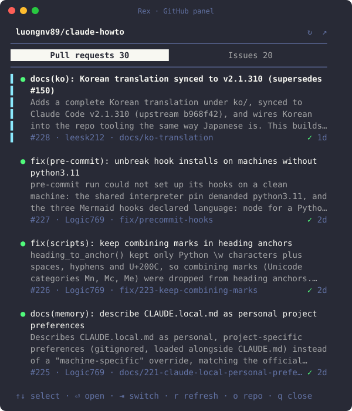

# GitHub panel for Rex

The open pull requests and issues of the repo you're in, in a side pane of Rex, the terminal multiplexer. Works with GitHub and GitLab, including self-hosted GitLab and GitHub Enterprise.



Each row shows the title (up to 2 lines), the description (up to 3 lines) and a meta line:

- **Pull requests** (merge requests on GitLab): number, author and branch, a Draft chip, the review state (Approved, Changes requested, Review), the checks (✓ passed, ● pending, ✗ failed) and the age.
- **Issues:** number and author, up to 3 labels in their colors, and the age.

The selected row also shows its URL on one more line.

On GitLab, merge requests show as `!123` and have no checks mark: the list doesn't carry pipeline status. Their review state shows Changes requested and Review, but not Approved.

Click a pull request or issue, or select it and press enter, to open it in your browser.

On GitHub, each issue has a **Resolve** button and each pull request a **Review** button, which start an agent on it. Which agent, model and thinking level is up to you: see [Agent profiles](#agent-profiles). So is the prompt it gets: see [Custom prompts](#custom-prompts).

It is the Rex twin of [herdr-github](https://github.com/luongnv89/herdr-github), the same panel for herdr.

## Install

Rex has no plugin manager: its extensions are Lua in `init.lua`. Clone [rex-extensions](../README.md) anywhere, then let the panel add itself to your config:

```sh
git clone https://github.com/luongnv89/rex-extensions ~/.config/rex/rex-extensions
node ~/.config/rex/rex-extensions/github/install.js
```

`install.js` adds three lines to the `init.lua` Rex reads, then runs `rex config reload`:

```lua
-- rex-github: the PR and issue panel (https://github.com/luongnv89/rex-extensions/tree/main/github)
dofile("/Users/you/.config/rex/rex-extensions/github/rex-github.lua")
rex.bind("cmd+shift+g", "github_panel")
```

The file is `REX_CONFIG` when that's set, else `$XDG_CONFIG_HOME/rex/init.lua`, else `~/.config/rex/init.lua`; it's created if it doesn't exist.

- **Which key:** `cmd+shift+g`. If your `init.lua` already binds it, it takes the first free one of `cmd+alt+g`, `ctrl+shift+g`, `cmd+shift+i` and `ctrl+alt+g`, and says which. To choose, run `node github/install.js ctrl+alt+p`; it refuses a key your `init.lua` already binds. It can't see the shortcuts built into the Rex app, so if the key does something else, pick another one.
- **Safety:** if `rex config check` already reports a problem with your `init.lua`, it changes nothing, exits 1 and quotes the problem. If the check rejects the edited file, it puts the old one back and exits 1. It saves the old file next to it, as `init.lua.bak-rex-github`. If `init.lua` already loads `rex-github.lua`, it changes nothing.
- **Without a key:** the action is also in Rex's command palette, as **PR and Issue Panel**, and `rex do github_panel` runs it from a shell.

To update, `git pull` in the folder you cloned. To remove it, run `node github/install.js --remove`, which takes those three lines out again.

## Use

Press the key in any pane. The panel opens on the right of the tab, a third of its width. Press the key again in that tab, from any pane, to close it.

- **Which repo:** the folder of the last pane you focused in the panel's tab. It follows you when you `cd` or move to another pane.
- **Which site:** read from the repo's `origin` remote (or its first remote). A host name containing `github` uses `gh`, one containing `gitlab` uses `glab`, and any other host tries `gh`, then `glab`.
- **Keys:**
  - `↑`/`↓` or `j`/`k` select, page up/down jump, `g`/`G` go to the top or bottom;
  - enter opens the selected row in your browser;
  - tab or `←`/`→` switches between pull requests and issues, `1` and `2` choose one;
  - `r` refreshes, `o` opens the repo on GitHub or GitLab;
  - `a` resolves the selected issue, or reviews the selected pull request, with an agent (see [Resolve and review with an agent](#resolve-and-review-with-an-agent)). With more than one profile it opens a menu of them: `↑`/`↓` or `j`/`k` choose, enter starts the one chosen, and esc or `q` closes the menu without starting anything;
  - `s` opens the agent profiles (see [Agent profiles](#agent-profiles));
  - `q` or esc closes the panel.
- **Mouse:** click a row to open it, click the switch to change lists, click a row's `Resolve #N` or `Review #N` button, the same button in the header (for the selected row), `⚙`, `↻` or `↗` in the header, a profile in the menu those buttons open, and scroll with the wheel.
- **When a row can't be opened:** the panel shows why in red, a hint to Cmd- or Ctrl-click the URL, and the whole URL above the key hints. The URL is a terminal hyperlink too. Any key, or the next open, clears it.
- **Fetching:** when the repo changes, every 2 minutes while the panel's tab is the one its session shows, and on `r`.
- **Lists:** the 50 most recently opened of each on GitHub, and the 50 most recently updated on GitLab. The panel remembers which list you chose.

## Resolve and review with an agent

On GitHub, every issue row ends with a **Resolve #N** button and every pull request row with a **Review #N** button. The header shows the same button for the selected row, and `a` presses it. Resolve hands the issue to the `issue-resolver` skill, Review hands the pull request to `issue-pr-review`, unless you wrote your own prompt for the action (see [Custom prompts](#custom-prompts)). The agent that starts is the one in the profile you choose; with no profiles of your own, it's Claude Code started through `mcc run` (see [Agent profiles](#agent-profiles)).

### Choose the profile

With no profiles of your own, only the built-in one, a click or `a` starts it right away. With one or more of your own, a click or `a` first opens a menu that lists every profile, the built-in **Claude Code via mcc run** first, with the one assigned to the action highlighted (the built-in one when none is).

The menu opens under the button you clicked: under a row's **Resolve #N** or **Review #N** for that row (and for `a`, under the selected row's), or under the header for the header's button and for a row whose button is out of view. When there's no room under the button, it opens above it, and a menu longer than the room scrolls, with `↑` or `↓` on its border when there are more profiles that way. `↑`/`↓` or `j`/`k` move the highlight, enter starts the highlighted profile, and a click on a profile starts that one. Esc, `q`, the mouse wheel or a click anywhere else closes the menu and starts nothing: a click on a row then doesn't open it in your browser.

Whichever profile you choose, the action's custom prompt is sent, if it has one. The panel reads the profiles file again when you choose: if the profile was deleted meanwhile, or the row left the list in a refresh, nothing starts and the panel says why. Choosing doesn't change which profile is assigned to the action.

### What it runs

Once the profile is known, the panel:

1. takes the action's custom prompt from the profiles file, if it has one;
2. checks that the skill is installed for that agent: `issue-resolver` for an issue, `issue-pr-review` for a pull request (not with a custom prompt);
3. finds where the new pane goes: below your agent, the one in the pane the panel follows, else one in another pane of the panel's tab, else below the pane the panel follows. It reads each pane's foreground program from Rex, and knows `claude`, `codex`, `gemini`, `opencode` and `pi`;
4. opens a new pane there, in the repo's folder, labelled `resolve-N` or `review-N`, and starts the profile's agent in it with its model and thinking level, and the prompt as the last word of its command line: for Claude `/issue-resolver 12` or `/issue-pr-review 34`; other agents get "Use the issue-resolver skill on issue #12." With a custom prompt, it sends that prompt with the number filled in. Nothing from the title or description goes into the prompt;
5. checks after 3 seconds that the agent is still running.

The command lines are `mcc run -- [flags] <prompt>` (with mcc's full path), `claude [flags] <prompt>`, `codex [flags] <prompt>`, `pi [flags] <prompt>` and `opencode --prompt <prompt>`. Rex passes each word as it is, so no shell reads the prompt.

Your own agent and its conversation are left alone, and focus stays where it was. The panel shows what it is doing above the key hints, in yellow while it starts the agent, green once it runs, and red with the reason when something fails. If the agent fails at once, Rex keeps its pane open so you can read why.

If the new agent asks you something first, such as whether you trust the folder, answer it in the new pane: the prompt was given on its command line, so it runs once you do.

mcc can ask something before Claude Code starts, such as what to do about a usage limit. Rex can't tell mcc from the Claude Code it starts, so for mcc the panel says it opened the pane, not that Claude Code started: if mcc asks something, answer it in the new pane, and Claude Code then works on the prompt.

If the skill isn't installed, nothing starts and the panel points you to [luongnv.com/idd](https://luongnv.com/idd) to install the skills. It looks for `<skill>/SKILL.md` in the `skills` folder of `~/.claude`, `~/.agents`, `~/.codex` and `~/.<agent>`, and of the same folders in the repo. For Claude it also looks in the plugins you have installed and not disabled (`~/.claude/plugins/installed_plugins.json`, `enabledPlugins` in `~/.claude/settings.json` and the repo's `.claude/settings*.json`), and in synced plugins, and sends a plugin's skill under the plugin's name, such as `/idd:issue-resolver 12`. For mcc, it runs `mcc env -q --shell bash` in the repo to find the Claude Code folder `mcc run` would use there, such as `~/.mcc/profiles/work`, and looks in that folder instead of `~/.claude`.

The buttons don't show on GitLab, because both skills work through `gh`.

## Custom prompts

Resolve and Review can each send a prompt you write instead of the IDD skill's. Write it with `{number}` where the issue's or pull request's number goes, such as:

```
Fix issue #{number} on a new branch, add a test, and open a pull request that closes it. Don't merge it.
```

`{number}` is required, can appear more than once, and is the only placeholder: the row's title and description never go into the prompt. The prompt is sent as written, as one argument, to every harness: it is the last word of the agent's command line, so `$`, quotes and backticks are just text. A custom prompt is trimmed and has to:

- contain `{number}`;
- not start with `-`, `!` or `#`, which a harness would read as a flag, a shell command or a note;
- not hold a backslash, a line break, or a control, invisible (zero-width, bidi), private-use or unassigned character;
- be at most 500 characters with the longest number filled in.

A custom prompt needs no skill, so the panel doesn't look for one: the agent starts even when the IDD skills aren't installed. With mcc, `mcc` still has to be on your `PATH`. Since the prompt goes as written to every harness, `/issue-resolver {number}` runs the skill only on Claude Code (directly or through mcc); another agent reads it as plain text. A skill Claude Code has from a plugin needs the plugin's name, such as `/idd:issue-resolver {number}`.

Leave the prompt empty to send the default again: the skill and the number, as above.

In the profiles view (`s`), the **Resolve prompt** and **Review prompt** rows under the profiles show the prompt each action sends (dim: the default). `↓` past the last profile selects them, and so does the mouse wheel; `e` or enter (or the selected row's **Edit** button) edits one. Type the prompt, then enter (or **Save**) saves it and esc (or **Cancel**) goes back. A prompt that can't be saved shows why under it. Empty it, or click **Use default**, to send the default again. In a short pane, the wheel scrolls the prompt down to its buttons.

The prompts are kept in the profiles file (see [Where they're kept](#where-theyre-kept)). A file with a custom prompt is version 2; without one, it stays version 1.

## Agent profiles

A profile says which agent Resolve or Review starts:

- **Name** and **id**: the id is 1 to 32 lowercase letters, digits or `-`. `default` is taken.
- **Harness**: Claude Code via `mcc run`, Claude Code, Codex, Pi or OpenCode.
- **Model** (optional): left empty, the harness uses its own default.
- **Thinking** (optional): only the levels the harness takes. Left empty, the harness uses its own default.

Resolve and Review each have their own profile: the one their menu highlights, ready for enter (see [Choose the profile](#choose-the-profile)). With none assigned, or when the assigned profile is deleted, that is the built-in **Claude Code via mcc run** profile, with no model or thinking flag. The built-in profile can be assigned but not changed or deleted.

How the fields become flags:

| Harness | Model | Thinking | Levels |
|---|---|---|---|
| Claude Code via `mcc run` | `--model M` | `--effort L` | low, medium, high, xhigh, max |
| Claude Code | `--model M` | `--effort L` | low, medium, high, xhigh, max |
| Codex | `-m M` | `-c model_reasoning_effort="L"` | low, medium, high, xhigh |
| Pi | `--model M` | `--thinking L` | off, minimal, low, medium, high, xhigh, max |
| OpenCode | none | none | none |

OpenCode has no model or thinking flag when it starts interactively, so a model set on an OpenCode profile is ignored. The profile form says so, and so does the notice when the agent starts.

A model is letters, digits and `. _ : / @ + -`, starting with a letter or digit. Spaces, quotes and other shell characters are refused, and so are aliases with brackets such as `opus[1m]`: use the full model name instead.

### Edit them

Press `s`, or click `⚙` in the header. `↑`/`↓` select a profile, `n` adds one, `e` or enter edits it, `d` deletes it (`y` confirms), `R` assigns it to Resolve and `V` to Review. With the mouse, click a profile to select it; it then shows **Use for Resolve**, **Use for Review**, **Edit** and **Delete** buttons (the default profile only the first two), and **+ New** in the header adds one. In the form, `↑`/`↓` or tab move between fields, `←`/`→` or space step through the harness and thinking choices, typing edits a text field, enter (or the **Save** button) saves and esc (or **Cancel**, or `✕`) goes back. A field that can't be saved shows why under it. Keys typed into a field stay in the field: `q` doesn't close the panel. Esc in the list goes back to the rows. In a narrow pane the key hints wrap onto more lines.

A profile that can't be saved shows why, in red, and nothing is written.

### Where they're kept

```
~/.config/rex-github/profiles.json
```

The file is per machine: it lives on the machine of the Rex server that holds the session, where the panel runs. It is the panel's own file, apart from [herdr-github](https://github.com/luongnv89/herdr-github)'s, though it has the same format: to use the profiles you made there, copy `~/.config/herdr/plugins/config/herdr-github/profiles.json` to it.

The panel reads the file when the profiles view opens and on every Resolve or Review click, and writes it only while it still holds what it read. If another panel changed it in the meantime, nothing is written, the view reads it again and asks you to make your change again. A file that isn't valid JSON, or is from a newer version of the panel, is shown read only and never overwritten; until you fix or delete it, the actions use the default. A file with a profile that can't be used (one edited by hand with a bad model, say) is read only too, so saving doesn't erase that profile or what it's assigned to: the view says which profile and why, the actions assigned to it use the default, and the other profiles still work. Fix or remove it in the file to save again. The same goes for a custom prompt that can't be used: the file is read only, and that action sends the default prompt until you fix it in the file.

## Remote hosts

The panel, and the `git`, `gh` and `glab` it runs, run on the machine of the Rex server that holds the session. So does the browser it opens: `open` (macOS) or `xdg-open` (Linux). When that server is another machine, a click opens nothing on yours, and the panel shows the reason and the URL instead. Cmd- or Ctrl-click the URL to open it where you sit, or select and copy it.

## Needs

- Rex on macOS or Linux, with a server that speaks API revision 8 or later (`rex version` shows it).
- Node 20 or later, as `node` on the `PATH` your login shell sets.
- For Resolve and Review with the default profile, `mcc` on that `PATH`, with the skills installed for the Claude Code profile it starts. Other profiles need their own agent installed instead.
- For GitHub repos, [`gh`](https://cli.github.com), logged in (`gh auth login`; add `--hostname` for GitHub Enterprise).
- For GitLab repos, [`glab`](https://gitlab.com/gitlab-org/cli), logged in (`glab auth login`; add `--hostname` for a self-hosted GitLab).

## What it runs

Rex runs `init.lua` and the panel as your user, with no sandbox. This one:

- in Rex's server, when you press the key: reads the session's layout, the folder of the focused pane's program, and opens or closes one pane labelled `rex-github` running `node panel.js`;
- in the panel: runs `git` in the repo's folder to find its remote, then `gh` or `glab` there to read the repo and its open pull requests (or merge requests) and issues;
- runs `rex api call` every 2 seconds to find the focused pane of its tab and that pane's folder;
- when you click Resolve or Review, or press `a`: reads the profiles file, runs `rex` to read the foreground program of the panes in its tab and `rex split` to open a pane that runs the profile's agent with the skill and the number, or your custom prompt. For mcc, it first runs `mcc env` in the repo. It reads the skill folders listed under [Resolve and review with an agent](#resolve-and-review-with-an-agent). With a custom prompt it doesn't run `mcc env` or read the skill folders;
- runs `open` (macOS) or `xdg-open` (Linux) when you open a row or the repo;
- when you run `install.js`: runs `rex config check`, a `rex do` script that loads your `init.lua` to list the keys it binds, edits `init.lua` (see [Install](#install)), and runs `rex config reload`;
- when you save in the profiles view: writes `~/.config/rex-github/profiles.json` (see [Where they're kept](#where-theyre-kept));
- otherwise writes only `~/.local/state/rex-github/view` (`$XDG_STATE_HOME/rex-github/view` when that's set): which list you chose.

It sends nothing anywhere except through `gh` to GitHub, or `glab` to GitLab.

## Troubleshooting

- **The key does nothing:** run `rex config check` and `rex keymap | grep github_panel`. If the Rex app has its own shortcut on that key, it may win: run `node github/install.js --remove`, then `node github/install.js` with another key. The palette entry **PR and Issue Panel** works either way.
- **The pane opens and shows `node: command not found`:** Rex starts the panel through your login shell, so `node` has to be on the `PATH` it sets (in `~/.zprofile` or `~/.profile`, not only in `~/.zshrc`).
- **"Not a git repository":** the focused pane's folder isn't inside a git repo. `cd` into one, or focus a pane that is.
- **A `gh` or `glab` error in red:** run the same command in that folder, for example `gh pr list` or `glab mr list`, to see the full message. Most often the CLI isn't logged in.
- **"gh isn't installed" or "glab isn't installed":** the repo's site needs that CLI on the `PATH` of your login shell. Install it (see [Needs](#needs)) and log in.
- **"No GitHub or GitLab remote":** the repo has no remote, or only a local-path one. Pull requests and issues live on a hosting site, so there is nothing to list.
- **Grey label dots on GitLab:** the label colors come from `glab label list`, which failed. Check `glab auth status`.
- **A row doesn't open, and the panel shows its URL with a red reason:** `open` or `xdg-open` is missing or failed, most often because the session's server is another machine. See [Remote hosts](#remote-hosts).
- **"The issue-resolver skill isn't installed" or "The issue-pr-review skill isn't installed":** install the skills from [luongnv.com/idd](https://luongnv.com/idd) for the agent named in the message, then try again.
- **"No agent in this tab and no pane to start one next to":** the panel opens the new pane below your agent, or below the pane it follows. Click a pane in the panel's tab, then try again.
- **"didn't start" or "closed right after it started":** the agent exited within 3 seconds. Its pane, if Rex kept it, shows why; otherwise run the command the notice shows yourself.
- **"mcc isn't on your PATH":** the default profile starts Claude Code through `mcc run`. Install mcc on the machine of the Rex server, or assign another profile to Resolve or Review (`s`).
- **"The issue-resolver skill isn't found for mcc":** `mcc env -q --shell bash`, run in the repo, didn't name a Claude Code folder. Run it there yourself to see why.
- **"Opened mcc in a new pane":** mcc runs there, and may be asking something before Claude Code starts, most often about a usage limit. Answer it in the new pane; Claude Code then works on the prompt.
- **"The profiles changed elsewhere and were read again":** another panel saved the profiles file after this one read it. Make your change again.
- **"The profiles file isn't valid JSON" or "is version N":** the file is read only until you fix or delete it, and the actions use the default meanwhile.
- **"Resolve prompt: must contain {number}" (or another reason under a prompt):** a custom prompt needs `{number}` where the number goes, and has to fit the rules under [Custom prompts](#custom-prompts). Nothing is saved until it does.
- **"A prompt in the file can't be used":** a prompt edited by hand in the profiles file breaks those rules. Its action sends the default meanwhile, and the file is read only: fix or remove the prompt in the file.
- **A custom prompt like `/issue-resolver {number}` does nothing on Codex, Pi or OpenCode:** a custom prompt is sent as written, and only Claude Code runs a `/skill` as a command. Write it as prose for other agents, such as `Use the issue-resolver skill on issue #{number}.`, or leave it empty for the default.

## Develop

```sh
git clone https://github.com/luongnv89/rex-extensions
cd rex-extensions/github
node --test
```

`rex do ./rex-github.lua --action github_panel` runs the action from your clone without installing it. A change to `panel.js` shows the next time the panel opens; a change to `rex-github.lua` needs `rex config reload`. `node panel.js` also runs the panel in any terminal, for the current folder.

- `rex-github.lua`: the `github_panel` action, which opens the panel beside the focused pane or closes it.
- `panel.js`: the panel itself. Plain Node, no npm packages.
- `profiles.cjs`: the agent profiles and custom prompts: their rules, the file's format, and how a profile becomes a command line. A copy of herdr-github's, with Rex's file path.
- `install.js`: adds the panel and a key to `init.lua`, or takes them out.
- `test/`: unit tests for the text and row rendering, for reading GitHub and GitLab JSON, for which row a click opens, for what a failed open shows and how URLs and links are drawn, for following the focused pane and what Resolve and Review run with each profile and custom prompt, with stand-ins for `rex` and `mcc`, for the profile menu and the profiles view, for the profiles' rules and file, and for which key `install.js` picks and how it edits `init.lua`.

## License

[MIT](../LICENSE)
